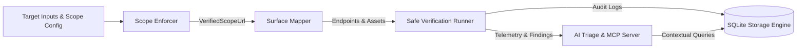

# System Architecture and Design

## Pipeline Architecture

BountyScope is architected as a modular, unidirectional data pipeline designed to discover, inspect, and evaluate security posture while guaranteeing scope isolation at every boundary.



The pipeline operates in four deterministic stages:

### 1. Scope Enforcer
The Scope Enforcer serves as the perimeter gateway for all network operations. It parses target boundary definitions (`scope.yaml`), canonicalizes domain names and IP literals, normalizes URI paths, and evaluates inclusion/exclusion sets. 

The Enforcer outputs an opaque, verified token: `VerifiedScopeUrl`. Outbound HTTP clients within the engine require an instance of `VerifiedScopeUrl` as their target parameter, establishing a compile-time guarantee that unvalidated destinations cannot receive network traffic.

### 2. Surface Mapper
The Surface Mapper ingests authorized URLs and systematically uncovers the visible web surface through passive and non-destructive mechanisms:
- **HTML Link & Script Extraction:** Parses HTML document structures using standard DOM selectors (`a[href]`, `script[src]`), resolves relative paths against the seed origin, and validates candidate URLs through `ScopeEnforcer`. Out-of-scope targets (such as external CDNs or excluded paths) are discarded and accounted for in mapping metrics.
- **JavaScript Route Extraction:** Mines candidate relative API routes (`/api/...`, `/v1/...`, `/v2/...`, `/graphql`) from external in-scope JavaScript bundles and inline `<script>` blocks using pattern matching, resolving each against the origin and validating against scope boundaries.
- **Technical Asset & Specification Discovery:** Probes standard technical asset files (`/robots.txt`) to uncover disallowed/allowed application paths, and probes common API documentation paths (`/openapi.json`, `/swagger.json`, `/v3/api-docs`).
- **Soft-404 Filtering:** Rejects HTML responses returning HTTP 200 on specification paths, and enforces schema verification requiring valid JSON structures with `openapi` or `swagger` root keys before classifying endpoints as `openapi_spec`.
- **Deduplicated SQLite Persistence:** Stores all verified in-scope endpoints in the SQLite `endpoints` table using upsert logic (`ON CONFLICT(url) DO UPDATE`) to refresh verification timestamps without creating duplicate database rows.

### 3. Safe Verification Runner
The Verification Runner evaluates security policies and configuration baselines against mapped surface elements:
- Auditing HTTP security headers (`Content-Security-Policy`, `Strict-Transport-Security`, `X-Content-Type-Options`, `X-Frame-Options`).
- Auditing Cross-Origin Resource Sharing (CORS) policies using safe origin reflections (`null`, arbitrary origins, trusted subdomains).
- Detecting information disclosure in response headers (`Server`, `X-Powered-By`, framework-specific debug headers).
- Verifying accessibility and authorization boundaries of published AI tool interfaces and MCP endpoints.

### 4. AI Triage & MCP Server
The AI Triage and Model Context Protocol (MCP) server component aggregates telemetry and structured findings:
- Normalizes discovered endpoints and observed findings into structured schemas.
- Interfaces with external AI assessment tools and analyst consoles via standard MCP tools and resources.
- Provides contextual scope queries, preventing external automation agents from initiating out-of-scope probes.

---

## Compile-Time Safety Model: `VerifiedScopeUrl`

To eliminate accidental out-of-scope network transmission, BountyScope implements the Type State pattern in Rust.

```
                    +---------------------------+
                    | Raw String / Unparsed URL |
                    +---------------------------+
                                  |
                                  v
                    +---------------------------+
                    |   ScopeEnforcer::check()  |
                    +---------------------------+
                       /                     \
        [Disallowed / Error]             [Allowed]
                     v                         v
        +-------------------------+   +-----------------------------+
        | ScopeError::Disallowed  |   | VerifiedScopeUrl (Private)  |
        +-------------------------+   +-----------------------------+
                                                     |
                                                     v
                                      +-----------------------------+
                                      | HttpClient::execute(target) |
                                      +-----------------------------+
```

### Invariants Enforced by `VerifiedScopeUrl`:
1. **Private Construction:** The inner `url::Url` instance cannot be constructed directly outside the `scope` module. The only public constructor is `ScopeEnforcer::validate_url(&self, raw: &str) -> Result<VerifiedScopeUrl, ScopeError>`.
2. **Immutability:** Once wrapped, the destination host and path cannot be mutated without re-validating against the enforcer.
3. **Restricted Consumer Interface:** The internal HTTP dispatch layer accepts `&VerifiedScopeUrl` rather than `&str` or `&reqwest::Url`.

---

## Scoped HTTP Client (`ScopedHttpClient`)

The outbound HTTP dispatcher enforces strict security invariants at the transport layer:

1. **Compile-Time Target Verification:** `ScopedHttpClient::get(&self, target: &VerifiedScopeUrl)` strictly accepts verified tokens. Raw string or untrusted URL invocations fail compilation.
2. **Prohibition of Automatic Redirects:** Configured with `reqwest::redirect::Policy::none()`. If a remote host responds with an HTTP 301, 302, 307, or 308 redirect, the client captures the `Location` header in `HttpProbeResponse::redirect_location` without following it. Callers must pass any redirect target back through the `ScopeEnforcer` before dispatching a subsequent probe, preventing redirect-based scope escapes.
3. **Deterministic Inter-Request Rate Limiting:** Enforces minimum inter-request spacing derived from `rate_limit_rps` (e.g., 2 rps = 500 ms minimum interval) across concurrent tasks using internal mutex scheduling.
4. **Response Payload Size Ceiling:** Implements a strict 5 MiB (`5 * 1024 * 1024` bytes) maximum response body limit via chunked stream monitoring. Responses exceeding this threshold return `HttpError::PayloadTooLarge` while recording an audit log entry, preventing unbounded memory allocation.
5. **Mandatory Audit Trail:** Every outbound request attempt and completion is logged synchronously into the SQLite `audit_logs` table.

---

## SQLite Storage Schema & Pragmas

All assessment data, mapped surface endpoints, and verified findings are persisted in a local, single-file SQLite database. 

### Mandatory Connection Pragmas
On opening every connection, the storage engine immediately executes:
```sql
PRAGMA journal_mode = WAL;
PRAGMA foreign_keys = ON;
```
- **Write-Ahead Logging (WAL):** Supports concurrent reader tasks without blocking active single-writer transactions.
- **Foreign Key Constraints (`ON`):** Prevents orphan scope rules, findings, or audit entries. Any attempt to record interaction data against non-existent program IDs fails immediately.

```sql
-- Target scope metadata
CREATE TABLE IF NOT EXISTS programs (
    id TEXT PRIMARY KEY,
    name TEXT NOT NULL UNIQUE,
    platform TEXT NOT NULL,
    created_at TIMESTAMP NOT NULL DEFAULT CURRENT_TIMESTAMP,
    updated_at TIMESTAMP NOT NULL DEFAULT CURRENT_TIMESTAMP
);

-- Target scope rules
CREATE TABLE IF NOT EXISTS scope_rules (
    id TEXT PRIMARY KEY,
    program_id TEXT NOT NULL REFERENCES programs(id) ON DELETE CASCADE,
    rule_type TEXT NOT NULL CHECK (rule_type IN ('allow_domain', 'exclude_domain', 'exclude_path')),
    pattern TEXT NOT NULL,
    created_at TIMESTAMP NOT NULL DEFAULT CURRENT_TIMESTAMP
);

-- Discovered attack surface endpoints
CREATE TABLE IF NOT EXISTS endpoints (
    id TEXT PRIMARY KEY,
    program_id TEXT NOT NULL REFERENCES programs(id) ON DELETE CASCADE,
    url TEXT NOT NULL UNIQUE,
    host TEXT NOT NULL,
    path TEXT NOT NULL,
    method TEXT NOT NULL DEFAULT 'GET',
    discovered_via TEXT NOT NULL, -- 'html_link', 'js_bundle', 'openapi_spec', 'manual'
    status_code INTEGER,
    response_size INTEGER,
    content_type TEXT,
    created_at TIMESTAMP NOT NULL DEFAULT CURRENT_TIMESTAMP,
    last_verified_at TIMESTAMP
);

-- Verified security findings and policy violations
CREATE TABLE IF NOT EXISTS findings (
    id TEXT PRIMARY KEY,
    program_id TEXT NOT NULL REFERENCES programs(id) ON DELETE CASCADE,
    endpoint_id TEXT REFERENCES endpoints(id) ON DELETE SET NULL,
    finding_type TEXT NOT NULL, -- 'cors_misconfiguration', 'missing_security_headers', 'exposed_api_spec', 'auth_bypass'
    severity TEXT NOT NULL CHECK (severity IN ('INFO', 'LOW', 'MEDIUM', 'HIGH', 'CRITICAL')),
    title TEXT NOT NULL,
    description TEXT NOT NULL,
    evidence TEXT NOT NULL, -- JSON-formatted request/response details
    remediation TEXT,
    verified_at TIMESTAMP NOT NULL DEFAULT CURRENT_TIMESTAMP
);

-- Complete audit log of every outbound network interaction
CREATE TABLE IF NOT EXISTS audit_logs (
    id INTEGER PRIMARY KEY AUTOINCREMENT,
    program_id TEXT NOT NULL REFERENCES programs(id) ON DELETE CASCADE,
    target_url TEXT NOT NULL,
    http_method TEXT NOT NULL,
    status_code INTEGER,
    duration_ms INTEGER NOT NULL,
    rate_limited BOOLEAN NOT NULL DEFAULT 0,
    timestamp TIMESTAMP NOT NULL DEFAULT CURRENT_TIMESTAMP
);

CREATE INDEX IF NOT EXISTS idx_endpoints_host ON endpoints(host);
CREATE INDEX IF NOT EXISTS idx_findings_program ON findings(program_id);
CREATE INDEX IF NOT EXISTS idx_audit_logs_timestamp ON audit_logs(timestamp);
```
