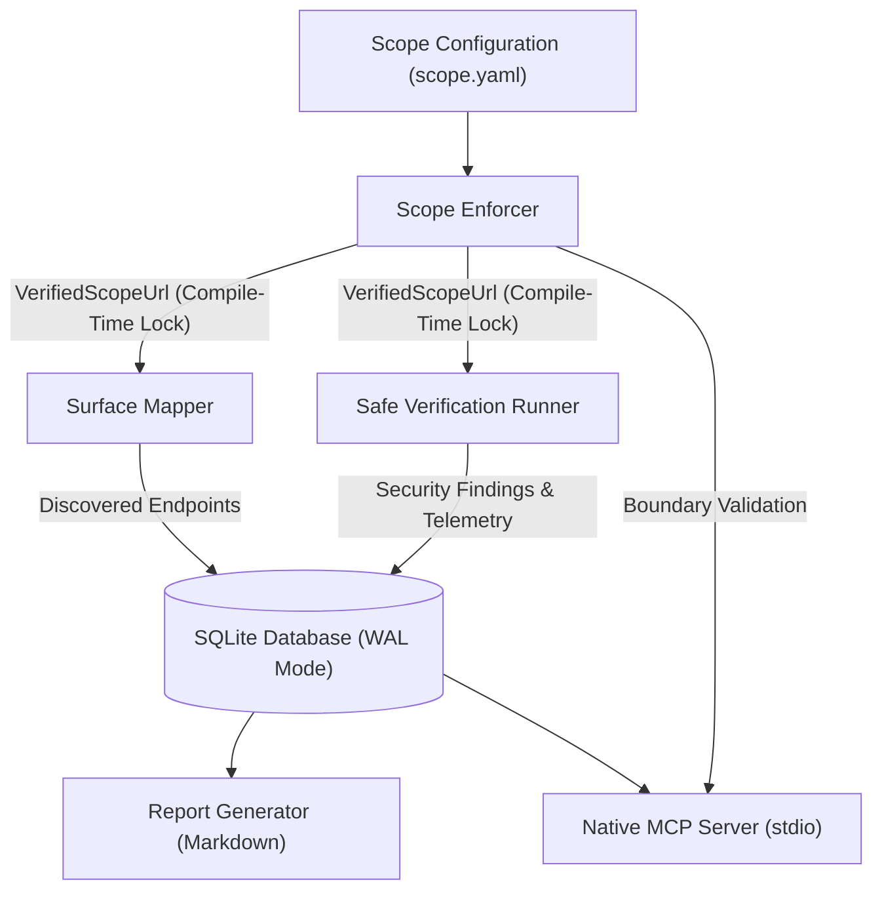

# BountyScope Consolidated Technical Reference

**Document Version:** 0.17.1  
**Specification Level:** Final Technical Reference  
**Applicability:** `bountyscope` CLI and Core Subsystems  

---

## 1. System Purpose & Foundational Invariants

BountyScope is a scope-locked reconnaissance, passive policy verification, and Model Context Protocol (MCP) triage engine written in Rust. The system is engineered specifically for authorized bug bounty assessments, vulnerability disclosure programs, and defensive security audits. It automates attack surface mapping and policy compliance evaluation while enforcing strict mathematical and compile-time boundaries to eliminate unintended traffic, denial of service conditions, or out-of-scope interactions.

### Foundational Invariants

All operations throughout BountyScope are governed by six inviolable architectural invariants:

1. **Fail-Closed Authorization:**  
   Every target domain, IP address, and URI path is treated as unauthorized until explicitly validated against the target scope specification. Any unparseable, ambiguous, or malformed URL immediately aborts execution.
2. **Compile-Time Scope Enforcement (`VerifiedScopeUrl`):**  
   The HTTP networking layer cannot accept raw string representations or unvalidated URL types. Outbound requests strictly require an unforgeable token (`VerifiedScopeUrl`) whose private constructor can only be invoked through `ScopeEnforcer::validate_url()`.
3. **Socket-Level DNS IP Guard (`ScopeAwareDnsResolver`):**  
   Before TCP socket connection, every resolved `SocketAddr` is inspected. Resolutions to loopback (`127.0.0.0/8`, `::1`), RFC 1918 private subnets (`10.0.0.0/8`, `172.16.0.0/12`, `192.168.0.0/16`), link-local (`169.254.0.0/16`, `fe80::/10`), CGNAT (`100.64.0.0/10`), or IPv4-mapped IPv6 addresses are blocked unless explicitly permitted in `scope.yaml`.
4. **Deterministic Rate and Concurrency Controls:**  
   Outbound requests are metered by an internal mutex-scheduled token bucket derived from `rate_limit_rps` (defaulting to 2 requests per second in safe mode). Concurrency is deterministic to prevent service degradation.
5. **Streamed Response Payload Ceiling (`5 MiB`):**  
   The HTTP client enforces a strict response body limit of 5 MiB (`5 * 1024 * 1024` bytes) using chunked stream consumption. Responses exceeding this threshold return `HttpError::PayloadTooLarge` while recording an audit log entry, preventing unbounded memory allocation or denial-of-service against the scanner.
6. **Non-Destructive Inspection Guarantee:**  
   The engine performs passive analysis, metadata extraction, configuration inspection, and read-only schema discovery. No mutating requests (such as state-changing POST/PUT/DELETE, credential testing, or automated fuzzing) are performed.

---

## 2. End-to-End Pipeline Architecture & Module Map

BountyScope employs a unidirectional data pipeline where each subsystem depends solely on verified upstream contracts.

### Architecture Pipeline Diagram



### Module Map

The codebase is organized into modular subsystems under `src/`:

| Module | File Path | Core Responsibilities |
|---|---|---|
| `lib` | `src/lib.rs` | Exposes public API modules, crate-level re-exports, and integration targets. |
| `main` | `src/main.rs` | CLI entry point using `clap` derive macros, environment variable fallback (`BOUNTYSCOPE_CONFIG`), default path resolution (`data/`), and pipeline command orchestration. |
| `scope` | `src/scope/mod.rs` | YAML scope parsing (`ScopeConfig`), domain/IP canonicalization, lexical path traversal normalization, wildcard DNS boundary checks, and the opaque type-state token `VerifiedScopeUrl`. |
| `http` | `src/http/mod.rs` | Transport client (`ScopedHttpClient`, `HttpProbeResponse`) configured with `Policy::none()`, mutex-driven inter-request pacing, 5 MiB response chunk limits, researcher attribution headers, and synchronous audit logging. |
| `storage` | `src/storage/mod.rs` | SQLite persistence engine (`StorageEngine`) operating with `WAL` journaling and `foreign_keys = ON`, managing relational records for programs, scope rules, endpoints, findings, and audit logs. |
| `mapper` | `src/mapper/mod.rs` | Attack surface crawler (`SurfaceMapper`) executing DOM-based HTML link/script extraction, regex-based JavaScript API route mining, in-scope wildcard subdomain extraction, JavaScript source map inspection (`.js.map`), technical asset discovery (`/robots.txt`, `/sitemap.xml`, RFC 9116 `/.well-known/security.txt`), API specification discovery (`/openapi.json`), and soft-404 filtering. |
| `verifier` | `src/verifier/mod.rs` | Security policy evaluator (`SafeVerificationRunner`) checking HTML-gated headers (CSP, clickjacking), transport headers (HSTS, nosniff), CORS reflection, header disclosures, and unauthenticated AI/MCP endpoint posture. |
| `report` | `src/report/mod.rs` | Assessment report engine (`ReportGenerator`) rendering structured Markdown documents containing severity breakdown matrices, detailed finding descriptions, JSON evidence blocks, and remediation steps. |
| `mcp` | `src/mcp/mod.rs` | Native Model Context Protocol server (`BountyScopeMcpServer`) conforming to JSON-RPC 2.0 over standard I/O (`stdio`), providing declarative tools (`check_target_scope`, `list_mapped_endpoints`, `list_security_findings`, `generate_assessment_report`) with diagnostic output isolated to `stderr`. |

---

## 3. Boundary Canonicalization & Redirect Non-Following

Target scope evaluation requires strict canonicalization before boundary set comparisons.

### Canonicalization Rules

1. **FQDN Normalization:**  
   Hostnames are converted to lowercase ASCII using Punycode decoding for Internationalized Domain Names (IDN). Trailing dots representing absolute root DNS zones (e.g., `target.example.com.`) are stripped to prevent boundary bypasses (`target.example.com`).
2. **Wildcard DNS Boundaries:**  
   Wildcard domain patterns (e.g., `*.example.com`) strictly require domain component hierarchy alignment. A target `sub.api.example.com` or `api.example.com` matches, whereas prefix collisions such as `evilexample.com` or `attacker-example.com` are rejected.
3. **Private and Loopback IP Isolation:**  
   To prevent unintended Server-Side Request Forgery (SSRF) into internal networks, private IP allocations (RFC 1918: `10.0.0.0/8`, `172.16.0.0/12`, `192.168.0.0/16`), link-local allocations (RFC 3927: `169.254.0.0/16`), and loopback addresses (`127.0.0.0/8`, `::1`) are denied by default unless explicitly declared in `allowed_domains` for local testing.
4. **Lexical Path Traversal Normalization:**  
   Paths undergo recursive lexical resolution prior to exclusion checks:
   - Consecutive slashes (`//`) are collapsed into single slashes (`/`).
   - Relative directory traversal tokens (`/..`, `/./`) are resolved.
   - Percent-encoded traversal representations (such as `/%2e%2e/` or `/%2e/`) are decoded and collapsed.
   - Excluded path prefixes (e.g., `/logout`) match any normalized path starting with that prefix.

### HTTP Redirect Non-Following (`Policy::none()`)

BountyScope's HTTP transport is explicitly initialized with:
```rust
reqwest::redirect::Policy::none()
```

When a remote web server responds with an HTTP redirect status (`301 Moved Permanently`, `302 Found`, `307 Temporary Redirect`, `308 Permanent Redirect`), the client does not automatically follow the `Location` header. 

**Architectural Rationale:**  
Automatic redirect following is a common source of scope escapes in security tooling. A target host on an authorized domain could redirect requests to an out-of-scope third-party authentication provider (e.g., `auth.thirdparty.com`) or cloud metadata service (`169.254.169.254`). By terminating the request at the redirect boundary, BountyScope returns the redirect location to the caller. The destination must be passed back through `ScopeEnforcer::validate_url()` to acquire a new `VerifiedScopeUrl` before any subsequent request can be dispatched.

### Passive Surface Mapping Pipeline (`SurfaceMapper`)

The surface mapper crawls and catalogs attack surfaces starting from an authorized seed URL without performing aggressive fuzzing or destructive interactions. Every candidate endpoint is passed through `ScopeEnforcer::validate_url()`; out-of-scope candidates increment `out_of_scope_discarded` and are discarded before any network request can occur.

| Discovery Channel | `discovered_via` | Source Description & Scope Boundary Behavior |
|---|---|---|
| **Seed Target** | `seed` | The entry-point URL validated against `allowed_domains`. Recorded with response status, body size, and MIME content type. |
| **HTML Navigation** | `html_link` | Links extracted from `<a href="...">` elements. Fragment identifiers (`#...`) are stripped; relative paths are resolved against seed. |
| **Script Includes** | `html_script` | External scripts referenced via `<script src="...">`. In-scope bundles are fetched (subject to rate limit) to extract further routes. |
| **Route Literals** | `js_route` | Relative API endpoints matching `/(api\|v[0-9]+\|graphql)...` mined via regex from JavaScript bundles and inline scripts. |
| **Subdomain Extraction** | `js_subdomain` | Absolute `https://` / `http://` URLs extracted from HTML and script text. Enables automatic discovery of authorized wildcard subdomains (e.g., `*.example.com`) while strictly dropping excluded or unauthorized domains. |
| **JavaScript Source Maps** | `source_map` | Resolves `//# sourceMappingURL=...` directives. If the source map references an out-of-scope CDN (e.g. `cdn.external.com`), it fails closed immediately without dispatching requests. In-scope maps are fetched and parsed for JSON `"sources"` entries and embedded API routes. |
| **Robots Exclusion** | `robots_txt` | Probes `/robots.txt` and parses `Disallow:` and `Allow:` paths. Wildcards (`*`) are truncated to base paths; non-conforming or excluded paths are dropped. |
| **Sitemap XML** | `sitemap_xml` | Probes `/sitemap.xml`, rejects soft-404 HTML responses, and extracts canonical URLs from `<loc>` tags, passing each through `ScopeEnforcer`. |
| **Security Policies** | `security_txt` | Probes RFC 9116 `/.well-known/security.txt`. Extracts URIs from `Policy:`, `Canonical:`, and `Acknowledgments:` directives without flagging missing files as security findings. |
| **API Specifications** | `openapi_spec` | Probes candidate spec paths (`/openapi.json`, `/swagger.json`, `/v3/api-docs`). Discards soft-404 HTML pages and requires valid JSON containing root `openapi` or `swagger` keys. |

---

## 4. Scope Configuration Schema (`scope.yaml`)

BountyScope loads target definitions from YAML configuration files. Deserialization enforces `#[serde(deny_unknown_fields)]` to prevent undetected typos or invalid parameters.

### Schema Specification

| Field | Type | Required | Default | Description |
|---|---|---|---|---|
| `program_name` | String | Yes | - | Unique alphanumeric program identifier used for storage indexing and report headers. |
| `platform` | String | Yes | - | Origin platform (e.g., `hackerone`, `bugcrowd`, `intigriti`, `local`, `self_hosted`). |
| `allowed_domains` | List of Strings | Yes | - | Authoritative domain patterns and wildcards (`example.com`, `*.example.com`, `127.0.0.1`). |
| `excluded_domains` | List of Strings | No | `[]` | Subdomains or third-party hosts explicitly prohibited from receiving traffic. |
| `excluded_paths` | List of Strings | No | `[]` | URL path prefixes prohibited from execution (e.g., `/logout`, `/delete-account`). |
| `excluded_checks` | List of Strings | No | `[]` | Finding types suppressed from verification results (e.g., `missing_security_headers`). |
| `rate_limit_rps` | Unsigned 32-bit | No | `2` | Maximum outbound requests per second across concurrent tasks. |
| `safe_mode` | Boolean | No | `true` | Restricts operations to safe, read-only methods. |
| `researcher_handle` | String | No | `None` | If specified, injects `X-Bug-Bounty: <handle>` header into all outbound requests. |
| `policy_url` | String | No | `None` | Link to governing program policy or Safe Harbor terms recorded in reports. |

### Complete Configuration Example

```yaml
program_name: "production-bounty-program"
platform: "hackerone"

allowed_domains:
  - "example.com"
  - "*.example.com"
  - "127.0.0.1"

excluded_domains:
  - "auth.example.com"
  - "payments.example.com"
  - "status.example.com"

excluded_paths:
  - "/logout"
  - "/account/delete"
  - "/api/v1/auth/signout"
  - "/oauth/revoke"

excluded_checks:
  - "missing_security_headers"
  - "header_info_disclosure"

rate_limit_rps: 2
safe_mode: true
researcher_handle: "authorized-security-researcher"
policy_url: "https://hackerone.com/example-security-program"
```

---

## 5. SQLite Persistence Schema

All assessment artifacts, mapped surfaces, verified findings, and network logs are stored in a local SQLite database.

### Mandatory Pragmas

Upon establishing every SQLite connection, the engine executes:
```sql
PRAGMA journal_mode = WAL;
PRAGMA foreign_keys = ON;
PRAGMA user_version;
```
- **Write-Ahead Logging (WAL):** Allows simultaneous concurrent readers without blocking active single-writer transactions.
- **Foreign Key Constraints (`ON`):** Enforces relational integrity across all tables. Child records referencing deleted programs or endpoints are automatically cascaded or set to null.
- **Deterministic Schema Versioning (`user_version = 1`):** Tracks database migrations cleanly. Fresh databases initialize directly at version 1. Legacy databases lacking recent columns (e.g., `policy_url` on `programs`) are upgraded via verified `ALTER TABLE` statements before advancing `user_version` to 1.

### Table Definitions & Indexes

```sql
-- 1. Program metadata
CREATE TABLE IF NOT EXISTS programs (
    id TEXT PRIMARY KEY,
    name TEXT NOT NULL UNIQUE,
    platform TEXT NOT NULL,
    policy_url TEXT,
    created_at TIMESTAMP NOT NULL DEFAULT CURRENT_TIMESTAMP,
    updated_at TIMESTAMP NOT NULL DEFAULT CURRENT_TIMESTAMP
);

-- 2. Scope boundary rules
CREATE TABLE IF NOT EXISTS scope_rules (
    id TEXT PRIMARY KEY,
    program_id TEXT NOT NULL REFERENCES programs(id) ON DELETE CASCADE,
    rule_type TEXT NOT NULL CHECK (rule_type IN ('allow_domain', 'exclude_domain', 'exclude_path')),
    pattern TEXT NOT NULL,
    created_at TIMESTAMP NOT NULL DEFAULT CURRENT_TIMESTAMP
);

-- 3. Discovered attack surface endpoints
CREATE TABLE IF NOT EXISTS endpoints (
    id TEXT PRIMARY KEY,
    program_id TEXT NOT NULL REFERENCES programs(id) ON DELETE CASCADE,
    url TEXT NOT NULL UNIQUE,
    host TEXT NOT NULL,
    path TEXT NOT NULL,
    method TEXT NOT NULL DEFAULT 'GET',
    discovered_via TEXT NOT NULL,
    status_code INTEGER,
    response_size INTEGER,
    content_type TEXT,
    created_at TIMESTAMP NOT NULL DEFAULT CURRENT_TIMESTAMP,
    last_verified_at TIMESTAMP
);

-- 4. Verified security findings
CREATE TABLE IF NOT EXISTS findings (
    id TEXT PRIMARY KEY,
    program_id TEXT NOT NULL REFERENCES programs(id) ON DELETE CASCADE,
    endpoint_id TEXT REFERENCES endpoints(id) ON DELETE SET NULL,
    finding_type TEXT NOT NULL,
    severity TEXT NOT NULL CHECK (severity IN ('INFO', 'LOW', 'MEDIUM', 'HIGH', 'CRITICAL')),
    title TEXT NOT NULL,
    description TEXT NOT NULL,
    evidence TEXT NOT NULL,
    remediation TEXT,
    verified_at TIMESTAMP NOT NULL DEFAULT CURRENT_TIMESTAMP
);

-- 5. Outbound network interaction audit log
CREATE TABLE IF NOT EXISTS audit_logs (
    id INTEGER PRIMARY KEY AUTOINCREMENT,
    program_id TEXT NOT NULL REFERENCES programs(id) ON DELETE CASCADE,
    target_url TEXT NOT NULL,
    http_method TEXT NOT NULL,
    status_code INTEGER,
    duration_ms INTEGER NOT NULL,
    rate_limited BOOLEAN NOT NULL DEFAULT 0,
    timestamp TIMESTAMP NOT NULL DEFAULT CURRENT_TIMESTAMP
);

-- 6. Historical scan execution snapshots (user_version = 2)
CREATE TABLE IF NOT EXISTS scan_runs (
    id INTEGER PRIMARY KEY AUTOINCREMENT,
    program_id TEXT NOT NULL REFERENCES programs(id) ON DELETE CASCADE,
    created_at TIMESTAMP NOT NULL DEFAULT CURRENT_TIMESTAMP,
    endpoints_count INTEGER NOT NULL,
    findings_count INTEGER NOT NULL
);

-- 7. Snapshot item breakdown for regression diffing
CREATE TABLE IF NOT EXISTS scan_snapshot_items (
    id INTEGER PRIMARY KEY AUTOINCREMENT,
    scan_run_id INTEGER NOT NULL REFERENCES scan_runs(id) ON DELETE CASCADE,
    item_type TEXT NOT NULL,
    item_key TEXT NOT NULL,
    status_or_severity TEXT NOT NULL,
    summary TEXT NOT NULL
);

CREATE INDEX IF NOT EXISTS idx_endpoints_host ON endpoints(host);
CREATE INDEX IF NOT EXISTS idx_findings_program ON findings(program_id);
CREATE INDEX IF NOT EXISTS idx_audit_logs_timestamp ON audit_logs(timestamp);
CREATE INDEX IF NOT EXISTS idx_scan_runs_program ON scan_runs(program_id);
CREATE INDEX IF NOT EXISTS idx_scan_snapshot_items_run ON scan_snapshot_items(scan_run_id);
```

### Deterministic Schema Versioning & Migrations (`PRAGMA user_version`)

BountyScope enforces database migrations deterministically using SQLite's native `PRAGMA user_version`:
- **Version 0 to 1:** Automatically adds `policy_url TEXT` to legacy `programs` tables without data loss.
- **Version 1 to 2:** Deterministically provisions `scan_runs` and `scan_snapshot_items` with cascading foreign keys and indexes.
- **Idempotency:** Fresh database initializations advance directly to `user_version = 2`; re-opening existing databases bypasses redundant DDL statements.

---

## 6. Security Checks, Severity Model & False-Positive Filters

### Audited Security Checks

1. **HTML-Only Header Auditing:**  
   Browser-enforced defense-in-depth controls are evaluated strictly against responses where the `Content-Type` header contains `text/html`:
   - `Content-Security-Policy`: Missing header (`missing_security_headers`) or permissive directives containing `'unsafe-inline'` or `'unsafe-eval'` (`weak_csp`).
   - Clickjacking Protection: Absence of both CSP `frame-ancestors` and valid `X-Frame-Options` (`DENY` or `SAMEORIGIN`) (`missing_security_headers`).
2. **General Security Headers:**  
   Evaluated across all responses:
   - `X-Content-Type-Options`: Missing `nosniff` (`missing_security_headers`).
   - `Strict-Transport-Security`: Missing HSTS on HTTPS endpoints (`missing_security_headers`).
3. **Technology & Banner Information Disclosure:**  
   Identifies backend framework disclosure (`X-Powered-By`) and verbose software version banners (`Server: Apache/2.4.52`) containing numeric digits (`header_info_disclosure`).
4. **Cross-Origin Resource Sharing (CORS) Policy:**  
   Tests endpoints with `Origin: https://untrusted.example.invalid` and `Origin: null`:
   - Dynamic reflection of untrusted origin with `Access-Control-Allow-Credentials: true` (`cors_misconfiguration`, `HIGH`).
   - Dynamic reflection of untrusted origin without credentials (`cors_misconfiguration`, `MEDIUM`).
   - Reflection of `null` origin with credentials (`cors_misconfiguration`, `HIGH`).
   - Static asset files (`.woff`, `.woff2`, `.css`, `.png`, `.jpg`, `.svg`) are exempted from CORS findings.
5. **Exposed API Specifications:**  
   Probes `/openapi.json`, `/swagger.json`, `/v3/api-docs`. Validates JSON/YAML syntax and required OpenAPI root keys, rejecting HTML soft-404 responses (`exposed_api_spec`, `INFO`).
6. **Unauthenticated AI & MCP Interfaces:**  
   Detects endpoints matching `/sse`, `/messages`, `/mcp`, `/v1/models` that return HTTP 200 without presenting a `WWW-Authenticate` challenge or requiring authentication tokens (`unauthenticated_ai_endpoint`, `HIGH`).

### Severity Classification Matrix

| Severity | Definition | Applicable Finding Types |
|---|---|---|
| **CRITICAL** | Direct privilege escalation, remote code execution, or unrestricted data exfiltration without credentials. | Confirmed state takeover, unauthenticated administrative MCP invocation. |
| **HIGH** | Significant access boundary failure or credentialed cross-origin read. | `cors_misconfiguration` (with credentials), `unauthenticated_ai_endpoint`. |
| **MEDIUM** | Uncredentialed cross-origin access or exploitable defense weakness. | `cors_misconfiguration` (uncredentialed arbitrary origin reflection). |
| **LOW** | Missing browser-enforced isolation header or weakened CSP. | `missing_security_headers` (CSP, XFO, XCTO, HSTS), `weak_csp`. |
| **INFO** | Defensive telemetry, software banner disclosures, or public API specifications. | `exposed_api_spec`, `header_info_disclosure`. |

### Deterministic False-Positive Filters

- **MIME / Content-Type Filtering:** Probes targeting API documentation or JSON endpoints must return matching MIME types. HTML error pages returning HTTP 200 are discarded.
- **Static Asset Exemption:** Static assets matching image, font, and stylesheet extensions are ignored by CORS auditing because open resource sharing is standard browser behavior.
- **Legacy Header Deduplication:** If `Content-Security-Policy` defines `frame-ancestors`, missing `X-Frame-Options` is not flagged as a vulnerability.
- **Rate-Limit Backoff Isolation:** HTTP 429 and 503 challenge responses are excluded from security findings to prevent evaluating WAF/CDN challenge pages as application logic.
- **Configured Rule Suppression:** Any finding matching an entry in `excluded_checks` is dropped prior to database persistence and omitted from summary metrics.

---

## 7. CLI Subcommands, Ergonomics & MCP Server

### Ergonomics & Default Resolution

- **Environment Variable Fallback:** All subcommands accept `BOUNTYSCOPE_CONFIG` as a fallback when `--config` is omitted.
- **Deterministic Database Path:** When `--db` is omitted, BountyScope derives `data/<sanitized_program_name>.db` (sanitizing non-alphanumeric characters to `_`) and automatically creates parent directories via `std::fs::create_dir_all`.
- **Multi-Format Export & Deterministic Report Paths:** `scan`, `report`, and `diff` accept `--format md | json | sarif` (defaulting to `md`). When `--output` is omitted, the filename extension is automatically derived from the format:
  - `md` -> `data/<sanitized_program_name>_report.md` (or `_diff.md`)
  - `json` -> `data/<sanitized_program_name>_report.json` (or `_diff.json`)
  - `sarif` -> `data/<sanitized_program_name>_report.sarif`
- **Standard Output Streaming:** A `--stdout` flag is available on `report` and `diff` for shell piping, CI/CD parsing, and `jq` manipulation without filesystem side effects.

### Subcommand Reference

```bash
# 1. Validate scope YAML configuration
bountyscope validate-scope [--config <path>]

# 2. Unified assessment scan (map -> audit -> report)
bountyscope scan --url <seed_url> [--config <path>] [--db <path>] [--output <file>] [--format md|json|sarif]

# 3. Probe single target endpoint
bountyscope probe --url <target_url> [--config <path>] [--db <path>]

# 4. Passively map surface from seed URL
bountyscope map --url <seed_url> [--config <path>] [--db <path>]

# 5. Audit security posture of mapped endpoints
bountyscope audit [--config <path>] [--db <path>]

# 6. Generate assessment report in Markdown, JSON, or SARIF v2.1.0
bountyscope report [--config <path>] [--db <path>] [--output <file>] [--stdout] [--format md|json|sarif]

# 7. Compare scan snapshots and track regressions (Markdown or JSON)
bountyscope diff [--config <path>] [--db <path>] [--from <run_id>] [--to <run_id>] [--output <file>] [--stdout] [--format md|json]

# 8. Start Model Context Protocol (MCP) server
bountyscope mcp [--config <path>] [--db <path>]
```

### Machine-Readable Emitters: JSON & OASIS SARIF v2.1.0

BountyScope features two standardized machine-readable exporters:
1. **Structured JSON (`--format json`):**
   - Outputs a clean JSON schema with root keys: `schema_version`, `tool` (`name`, `version`), `program` (scope and attribution parameters), `summary` (total counts and severity distribution), `endpoints` (detailed surface inventory), and `findings` (containing parsed evidence objects and remediation).
   - Also implemented for `bountyscope diff --format json`, rendering structured regression metrics, endpoint additions/removals, status transitions, and newly identified security issues.
2. **OASIS SARIF v2.1.0 (`--format sarif`):**
   - Implements OASIS Static Analysis Results Interchange Format (version 2.1.0) conforming to `https://json.schemastore.org/sarif-2.1.0.json`.
   - Driver Component: `runs[0].tool.driver` contains name `"BountyScope"`, version `"0.17.1"`, information URI, and deduplicated `rules[]` entries with title descriptions, full descriptions, and remediation guidance.
   - Severity-to-Level Mapping:
     - `CRITICAL` / `HIGH` -> `"error"` (`security-severity: "9.0"` / `"7.0"`)
     - `MEDIUM` -> `"warning"` (`security-severity: "5.0"`)
     - `LOW` / `INFO` -> `"note"` (`security-severity: "3.0"` / `"1.0"`)
   - Location Anchoring: Findings map `locations[0].physicalLocation.artifactLocation.uri` directly to the affected endpoint URL for automatic PR annotations when uploaded via `github/codeql-action/upload-sarif`.

### Native Model Context Protocol (MCP) Server

The MCP server implements JSON-RPC 2.0 over standard I/O streams (`stdio`) via `rmcp`:
- **`stdout` Protocol Isolation:** Standard output is strictly reserved for newline-delimited JSON-RPC 2.0 messages. Any unexpected write to stdout invalidates protocol framing.
- **`stderr` Diagnostics:** All tracing events, operational diagnostics, and error messages are routed exclusively to standard error.

**Exposed MCP Tools:**
1. `check_target_scope`: Evaluates whether a URL falls within authorized boundaries (`{"allowed": bool, "normalized_url": Option<String>, "reason": Option<String>}`).
2. `list_mapped_endpoints`: Returns paginated lists of discovered endpoints for the active program.
3. `list_security_findings`: Returns security findings filtered optionally by minimum severity (`CRITICAL`, `HIGH`, `MEDIUM`, `LOW`, `INFO`).
4. `generate_assessment_report`: Compiles and returns the complete Markdown assessment report.
5. `diff_latest_scans`: Compares historical scan runs to detect regressions, status transitions, and surface additions (`{"from_run_id": Option<i64>, "to_run_id": Option<i64>}`).

---

## 8. Offline Local Docker Lab Workflow

BountyScope includes a self-contained offline testing lab located in `lab/` to verify scanning and mapping without generating external internet traffic.

### Architecture & Isolation

The lab runs two containerized services via Docker Compose:
- **OWASP Juice Shop (`127.0.0.1:3000`):** Simulates complex single-page applications, client-side JavaScript bundles, and RESTful APIs.
- **Mock API Service (`127.0.0.1:8080`):** Simulates OpenAPI specifications, customized `robots.txt` rules, and configurable HTTP headers.
- **Loopback Invariant:** All port bindings are bound strictly to `127.0.0.1`. Under no circumstances are ports published to `0.0.0.0`.

### Execution Workflow

```bash
# 1. Start lab containers in detached mode
cd lab
docker compose up -d

# 2. Verify container status
docker compose ps

# 3. Validate loopback scope configuration
cd ..
bountyscope validate-scope --config configs/scope.local.yaml

# 4. Run unified scan against local lab mock service
bountyscope scan --config configs/scope.local.yaml --url http://127.0.0.1:8080/

# 5. Or execute granular workflow
bountyscope map --config configs/scope.local.yaml --url http://127.0.0.1:8080/
bountyscope audit --config configs/scope.local.yaml
bountyscope report --config configs/scope.local.yaml --stdout

# 6. Stop lab environment when complete
cd lab
docker compose down
```

---

## 9. Threat Model & Operational Boundaries

BountyScope is designed under a defense-in-depth safety paradigm that enforces strict operational boundaries directly in software architecture.

### Built-in System Guarantees

1. **Compile-Time Scope Enforcement (`VerifiedScopeUrl`):**  
   All HTTP network operations strictly consume `VerifiedScopeUrl`. Because the type's constructor is private and can only be obtained through `ScopeEnforcer::validate_url()`, it is architecturally impossible for internal code or external callers to dispatch network requests to arbitrary unverified URLs.

2. **Socket-Level DNS IP Guard (`ScopeAwareDnsResolver`):**  
   Outbound network connections install a custom resolver implementing `reqwest::dns::Resolve` that intercepts resolution immediately before TCP socket creation. The resolver inspects every resolved `SocketAddr` (including IPv4-mapped IPv6) and rejects loopback (`127.0.0.0/8`, `::1`), RFC 1918 private (`10.0.0.0/8`, `172.16.0.0/12`, `192.168.0.0/16`), link-local (`169.254.0.0/16`, `fe80::/10`), CGNAT (`100.64.0.0/10`), and unspecified IPs unless that exact IP or loopback host was explicitly allowlisted in `scope.yaml`. This eliminates DNS rebinding and internal SSRF risks.

3. **Non-Redirecting Transport (`Policy::none()`):**  
   The HTTP transport engine enforces `reqwest::redirect::Policy::none()`. Standard HTTP redirect responses (`301 Moved Permanently`, `302 Found`, `307 Temporary Redirect`, `308 Permanent Redirect`) are captured passively as surface discovery telemetry rather than automatically followed. This prevents hostile redirect chains from leading the scanner outside configured scope boundaries or into private intranet infrastructure.

4. **Rate-Limited, Non-Destructive `GET`-Only Requests:**  
   Outbound requests are strictly limited to HTTP `GET` operations. All request dispatching is throttled through an asynchronous rate limiter governed by `rate_limit_rps` (defaulting to 2 requests per second). On receiving HTTP `429 Too Many Requests` or `503 Service Unavailable`, the engine applies bounded exponential backoff or honors numeric `Retry-After` headers (capped at 5 seconds) for up to 2 retries, logging `rate_limited = true` in the SQLite audit log.

5. **Streamed Payload Ceiling (`5 MiB`):**  
   Responses are streamed and chunked up to a maximum ceiling of 5 MiB (`MAX_RESPONSE_BODY_BYTES`). Payloads exceeding this limit immediately abort streaming and raise `HttpError::PayloadTooLarge`, preventing memory exhaustion or denial of service against the scanning host.

### Operator Responsibilities & Operational Limitations

While BountyScope provides robust automated boundaries, operators must remain aware of several operational limitations:

1. **Non-RESTful State Changes on HTTP `GET`:**  
   While BountyScope exclusively issues HTTP `GET` requests, poorly architected target applications may occasionally execute state-changing actions (such as session termination, account state modifications, or administrative triggers) via `GET` parameters. Operators are responsible for identifying sensitive administrative or mutating URL patterns and adding them to `excluded_paths` (e.g., `/logout`, `/admin/delete`, `/reset`).

2. **Socket-Level DNS Mitigation vs. Public DNS Flapping:**  
   While BountyScope actively eliminates DNS rebinding to internal, loopback, and cloud metadata infrastructure at the socket resolver layer, public-to-public DNS flapping or multi-tenant IP shifts remain governed by upstream authoritative DNS resolvers. Operators assessing multi-tenant public cloud environments should maintain current scope boundaries.

3. **Passive Inspection vs. Active Exploitation:**  
   BountyScope performs passive reconnaissance, metadata extraction, header auditing, and specification discovery. It intentionally does not conduct active vulnerability exploitation, state-changing mutation, SQL injection exploitation, remote code execution fuzzing, or credential brute-forcing. Findings indicate policy non-compliance, missing defenses, or specification exposures rather than confirmed exploitable compromise.

---

## 10. Continuous Integration & Cross-Platform Release Pipeline (v0.16.0)

BountyScope enforces full automated quality assurance and deterministic multi-architecture distribution via GitHub Actions.

### Continuous Integration (`.github/workflows/ci.yml`)

The CI workflow triggers automatically on every `push` to `main` and on all pull requests, executing a multi-platform matrix test suite across Linux, macOS, and Windows:

- **Target Matrix:** `ubuntu-latest`, `macos-latest`, `windows-latest`
- **Toolchain Management:** `dtolnay/rust-toolchain@stable` with `rustfmt` and `clippy` components.
- **Dependency Caching:** `Swatinem/rust-cache@v2` across matrix runners to ensure fast, deterministic feedback cycles.
- **Enforcement Pipeline:**
  - Code formatting: `cargo fmt --check` (enforced on Linux).
  - Static analysis: `cargo clippy --all-targets --all-features -- -D warnings` (zero warnings tolerance).
  - Unit and integration tests: `cargo test` across all platforms.

### Automated Cross-Platform Release Pipeline (`.github/workflows/release.yml`)

Triggered on any tag matching `v*` (such as `v0.16.0`), the release pipeline compiles standalone binaries across 4 distinct target triples:

| Target Platform | Target Triple | Distribution Archive | Checksum |
| :--- | :--- | :--- | :--- |
| **Linux (x86_64)** | `x86_64-unknown-linux-gnu` | `bountyscope-v<version>-linux-x86_64.tar.gz` | `.tar.gz.sha256` |
| **macOS (Apple Silicon)** | `aarch64-apple-darwin` | `bountyscope-v<version>-macos-aarch64.tar.gz` | `.tar.gz.sha256` |
| **macOS (Intel)** | `x86_64-apple-darwin` | `bountyscope-v<version>-macos-x86_64.tar.gz` | `.tar.gz.sha256` |
| **Windows (x86_64)** | `x86_64-pc-windows-msvc` | `bountyscope-v<version>-windows-x86_64.zip` | `.zip.sha256` |

Each distribution archive bundles:
1. The optimized release binary (`bountyscope` or `bountyscope.exe`).
2. Legal notice: `LICENSE`.
3. Quick start guide: `README.md`.
4. Template scope configuration: `configs/scope.example.yaml`.

Every packaged archive is cryptographically hashed using SHA-256 (`.sha256`), and all assets are attached directly to the GitHub Release via `softprops/action-gh-release@v2` with automated release notes.

---

## 11. Configuration Safety Guardrails & Strict Scope Linting (v0.16.1)

To prevent accidental out-of-scope traffic or dangerous misconfigurations prior to any network activity, BountyScope v0.16.1 introduces strict configuration linting via `ScopeConfig::lint_strict()` and the `bountyscope validate-scope --strict` CLI command (also exposed as the MCP `validate_scope` tool).

### 11.1 Strict Errors (Hard Failures)

When evaluated in strict mode (`--strict`), any of the following conditions produce a non-zero exit code (`1`) and abort scanning:

1. **Catch-All or TLD Wildcards:**
   - Empty `allowed_domains`.
   - Global wildcards (`*`).
   - Top-level domain (TLD) or public suffix wildcards (e.g., `*.com`, `*.org`, `*.in`, `*.co.uk`).
   - Single-label hostnames without registered domain components (e.g., `com`, `internal`).
2. **Unintended Raw IP / CIDR Targets:**
   - Raw IPv4 addresses (e.g., `192.168.1.1`), IPv6 addresses, or CIDR blocks (e.g., `10.0.0.0/8`, `fe80::/10`) in `allowed_domains` are rejected unless explicitly authorized via `allow_raw_ip_targets: true`.
3. **Safe Mode Invariants Violation:**
   - `rate_limit_rps` must be between `1` and `10` requests per second.
   - `max_depth` (if configured) must not exceed `5`.
4. **Contradictory Boundary Rules:**
   - Specifying an identical domain in both `allowed_domains` and `excluded_domains`.

### 11.2 Strict Warnings (Best Practice Guidance)

The linter also emits warnings to guide operators toward safe assessment practices:
- **Sensitive Unauthenticated State-Changing Paths:** Missing exclusions for destructive or session-terminating endpoints (`/logout`, `/signout`, `/unsubscribe`, `/delete`).
- **Broad Wildcard Domain Scope:** Specifying broad wildcards (`*.example.com`) without accompanying domain exclusions in `excluded_domains`.
- **Operator Attribution Missing:** External targets configured without `researcher_handle` or `user_agent` attribution headers.

### 11.3 CLI and MCP Protocol Integration

- **CLI Usage:**
  ```bash
  # Standard human-readable strict validation
  bountyscope validate-scope --config configs/scope.yaml --strict

  # Machine-readable JSON output for pre-flight CI/CD gates
  bountyscope validate-scope --config configs/scope.yaml --strict --json
  ```
- **MCP Tool:** The `validate_scope` tool accepts optional `config_yaml: string` and `strict: boolean` parameters, returning the structured `ScopeLintReport` to AI agents during automated triage sessions.
- **MCP Tool Annotations:** Every MCP tool explicitly signals standard capability hints (`read_only_hint: true`, `destructive_hint: false`, `idempotent_hint: true`, and `open_world_hint: false`) in `ToolAnnotations` so consuming AI systems and MCP clients operate with verified safety invariants.

---

## 12. Passive Tech-Stack & WAF/CDN Fingerprinting (v0.16.2)

BountyScope v0.16.2 introduces a zero-network-I/O passive technology, framework, web server, and WAF/CDN fingerprinting subsystem. It inspects only HTTP response status codes, headers, `Set-Cookie` names, and HTML body/meta tags already fetched during surface mapping—without initiating any extra network requests.

### 12.1 Taxonomy & Categories (`TechCategory`)

Detected technologies are categorized into five distinct architectural layers:

1. **`WafCdn` (Web Application Firewall / Content Delivery Network):**
   - Cloudflare: `cf-ray`, `cf-cache-status`, `__cf_bm` cookie name.
   - AWS CloudFront: `x-amz-cf-id`, `x-amz-cf-pop`, `via: cloudfront`.
   - Akamai: `x-akamai-transformed`, `akamai-origin-hop`, `x-akamai-request-id`.
   - Fastly: `x-fastly-request-id`, `fastly-debug-digest`.
   - Incapsula / Imperva: `x-iinfo`, `visid_incap` cookie name.

2. **`WebServer` (HTTP Servers & Reverse Proxies):**
   - Nginx, Apache HTTP Server, Microsoft-IIS, Caddy, OpenResty, LiteSpeed, Traefik, Envoy (detected via `Server` header banners and server tokens).

3. **`Framework` (Application Frameworks & Runtimes):**
   - Express: `x-powered-by: express`.
   - Next.js: `x-powered-by: Next.js`, `__NEXT_DATA__` HTML marker.
   - Django: `csrftoken` cookie name, Django debug / admin signatures.
   - Ruby on Rails: `x-rack-cache`, `_session_id` cookie naming pattern.
   - ASP.NET: `x-aspnet-version`, `x-aspnetmvc-version`, `ASP.NET_SessionId` cookie name.
   - Laravel: `x-powered-by: PHP`, `laravel_session` cookie name.
   - Spring Boot: `x-application-context`, standard Whitelabel Error Page markup.
   - Vue.js / React / Angular: Identified via client-side DOM root markers (`data-v-`, `data-reactroot`, `ng-version`).

4. **`Cms` (Content Management Systems):**
   - WordPress: `<meta name="generator" content="WordPress ...">`, `/wp-content/` and `/wp-includes/` resource paths.
   - Drupal: `x-generator: Drupal`, `drupal.js` asset references.
   - Joomla: `<meta name="generator" content="Joomla! ...">`.

5. **`HostingPlatform` (PaaS & Cloud Hosting Platforms):**
   - Vercel: `x-vercel-id`, `x-vercel-cache`.
   - Netlify: `x-nf-request-id`, `server: Netlify`.
   - Fly.io: `fly-request-id`.
   - Heroku: `via: ... vegur`.
   - GitHub Pages: `server: GitHub.com`.

### 12.2 Security & Credential Masking Guarantees

- **Cookie Secret Isolation:** Passive fingerprinting strictly extracts cookie names (the substring preceding the first `=` sign in `Set-Cookie`). Raw session tokens, cryptographic cookies, and user secrets (e.g., `PHPSESSID=secret123`, `jwt=eyJ...`) are never copied or persisted into evidence fields or report outputs.
- **Zero Additional Network I/O:** The engine operates in-memory on HTTP probe responses already captured by `SurfaceMapper`. It does not send active probes, options queries, or synthetic fuzzing payloads.

### 12.3 Storage, Reporting, and MCP Integration

- **SQLite Schema Migration (`PRAGMA user_version = 3`):**
  - Stored in the `detected_technologies` table with `UNIQUE(program_id, name, category)` ensuring deterministic per-program deduplication across endpoints.
  - Included as `item_type = 'technology'` in scan snapshot records.
- **Reports:**
  - Markdown: Generates a structured table in `## Detected Technology Stack` and delta summaries in `## Technologies & Infrastructure Changes`.
  - JSON: Serialized into `detected_technologies` array on `JsonReport` and `new_technologies` / `removed_technologies` on `JsonDiffReport`.
- **MCP Server:**
  - Added `list_detected_technologies` tool with explicit `ToolAnnotations` (`read_only_hint: true`, `destructive_hint: false`, `idempotent_hint: true`, `open_world_hint: false`).
  - Added detected technology regression metrics to `diff_latest_scans` outputs.

---

## 13. Scope-Locked Passive Subdomain Discovery via Certificate Transparency (v0.16.3)

BountyScope v0.16.3 introduces a dedicated, scope-locked passive Certificate Transparency (CT) subdomain discoverer (`CtLogDiscoverer` in `src/ct/mod.rs`). The engine queries public CT logs (`https://crt.sh/?q=%.<base_domain>&output=json`) to surface valid, registered subdomains while strictly enforcing scope boundary validation on every candidate hostname before storage or seed probing.

### 13.1 Eligible Base Domain Extraction

To ensure compliance with bug bounty rules of engagement and prevent wasteful queries, `extract_eligible_base_domains` processes `ScopeConfig::allowed_domains` with strict filtering:
- **Exclusion of IP Targets & Localhost:** Raw IPv4, IPv6 addresses, and loopback identifiers (`localhost`, `127.0.0.1`, `::1`) are immediately skipped.
- **Exclusion of Wildcards & TLD Fragments:** Broad top-level wildcards (`*`, `*.com`) and single-label entries are ignored.
- **Normalization to Registered Base Domain:** Normalized hostnames and wildcard subdomains (`*.example.com` or `api.example.com`) are stripped down to their registered base domain (`example.com`) and deduplicated.

### 13.2 Multiline SAN Parsing & Zero-Cost Scope Filtering

Public certificates frequently declare Subject Alternative Names (SANs) containing wildcard prefixes and third-party hostnames:
1. **Multiline Splitting & Wildcard Stripping:** `name_value` fields containing embedded newlines (`\n`) are split into individual SANs, lowercased, and stripped of leading `*.` fragments.
2. **Immediate Boundary Validation:** Every discovered hostname candidate is converted to a canonical HTTPS URL (`https://<hostname>/`) and evaluated via `ScopeEnforcer::validate_url()`.
3. **Fail-Closed Filtering:** Any hostname matching `excluded_domains`, `excluded_paths`, or falling outside the configured `allowed_domains` is immediately discarded before database persistence or network probing.

### 13.3 Network Resiliency & Graceful Degradation

Public Certificate Transparency logs (specifically `crt.sh`) frequently encounter heavy traffic, rate limits (`HTTP 429`), server unavailability (`HTTP 503`), or network latency spikes:
- `CtLogDiscoverer` uses a polite `User-Agent` incorporating the configured `researcher_handle` attribution header.
- Transient HTTP 429, 503, connection timeouts, or malformed JSON responses are treated non-fatally. The discoverer logs a diagnostic `[WARN]` to `stderr` and returns an empty list cleanly without crashing or aborting the broader scan workflow.

### 13.4 CLI, Diff, Reporting & MCP Integration

- **CLI Subcommand:** `bountyscope ct --config <path> [--json] [--db <path>]` provides standalone passive subdomain enumeration without crawling or probing.
- **Scan & Map Integration:** Flag `--enable-ct` / `--ct-logs` activates CT log querying in `SurfaceMapper::map`, seeding in-scope subdomains into the discovery queue under `discovered_via = "ct_log"`.
- **Snapshot Persistence & Diff:** Discovered subdomains are stored in SQLite (`endpoints` table and `scan_snapshot_items` with `item_type = 'subdomain'`). Differential analysis detects `new_subdomains` and `removed_subdomains` across historical scan runs.
- **Reports:** Markdown assessment reports include `## Discovered Subdomains`; diff reports display `## Subdomains & Hostname Changes`. JSON reports and diffs output `subdomains`, `new_subdomains`, and `removed_subdomains`.
- **MCP Tool:** `list_discovered_subdomains` tool enables external agents to query in-scope subdomains with optional `source` filtering, complete with standard `ToolAnnotations` hints (`read_only_hint: true`, `destructive_hint: false`, `idempotent_hint: true`, `open_world_hint: false`).

---

## 14. Passive JS & Source Map Secret / Token Pattern Detection (v0.16.4 / v0.17.0)

BountyScope v0.16.4 and v0.17.0 feature passive credential and sensitive token pattern detection (`SecretScanner` in `src/secrets/mod.rs`). The engine analyzes client-accessible assets already retrieved during surface mapping (inline scripts, external `.js` scripts, `.js.map` source maps) and verification runner audits with zero additional network requests.

### 14.1 Detection Rules & Pattern Matrix

| Rule ID | Severity | CWE | Pattern Description | False-Positive Mitigations |
| :--- | :--- | :--- | :--- | :--- |
| `exposed_aws_access_key` | HIGH | CWE-798 | AWS Access Key ID (`\b(AKIA[0-9A-Z]{16})\b`) | Filters `AKIA****MPLE`, `EXAMPLE`, `0000000000000000` |
| `exposed_google_api_key` | HIGH | CWE-798 | Google Cloud & Firebase API Key (`\b(AIza[0-9A-Za-z_\-]{35})\b`) | Filters dummy and documentation placeholders |
| `exposed_github_token` | HIGH | CWE-798 | GitHub PAT / Fine-Grained Token (`ghp_[0-9A-Za-z]{36}`, `github_pat_[0-9A-Za-z_]{22,}`) | Filters `example`, `dummy`, `your_token` |
| `exposed_stripe_key` | HIGH | CWE-798 | Stripe Live Secret / Restricted Key (`(sk\|rk)_live_[0-9a-zA-Z]{24,}`) | Ignores `pk_live_` (publishable) and `sk_test_` |
| `exposed_webhook_url` | HIGH | CWE-798 | Slack (`hooks.slack.com/services/...`) & Discord (`discord.com/api/webhooks/...`) | Filters dummy/example tokens |
| `exposed_private_key` | HIGH | CWE-312 | Private Key PEM Headers (`-----BEGIN (?:RSA\|EC\|OPENSSH\|DSA )?PRIVATE KEY-----`) | Filters example and test certificates |
| `exposed_bearer_jwt` | HIGH | CWE-798 | Hardcoded JWT or Bearer Assignment (`eyJ...`) | Filters example claims and non-credential tokens |
| `exposed_internal_host` | MEDIUM | CWE-200 | Internal TLDs (`.internal`, `.corp`, `.local`, `.staging`, `.test`) & RFC 1918 IPs | Filters `example.`, `schema.org`, `w3.org`, `localhost` |

### 14.2 Strict Evidence Redaction Invariant

BountyScope enforces a strict architectural redaction guarantee:
1. **Redaction Function (`redact_secret`):** For values longer than 8 characters, only the first 4 and last 4 characters are preserved, separated by `****` (e.g., `AKIA****7788`). For shorter strings, at most the first 4 characters are preserved followed by `****`.
2. **Fail-Safe Storage & Reporting:** The raw, unmasked secret string is **never** placed in `FindingEntry.evidence`, `FindingEntry.description`, or `FindingEntry.title`.
3. **Database & Downstream Formats:** SQLite records, Markdown tables, JSON exports, SARIF artifacts, and MCP responses receive only the sanitized, redacted form.

### 14.3 Finding Deduplication & Endpoint Capping

Client-side JavaScript bundles frequently repeat identical credentials or invoke minified libraries that match multiple patterns:
- Findings are deduplicated per endpoint by `(rule_id, masked_secret)`.
- A maximum threshold of 5 findings per rule per endpoint is enforced to prevent alert fatigue.

### 14.4 Configuration-Level Check Exclusion

Operators can disable secret detection globally or selectively in `scope.yaml`:
```yaml
excluded_checks:
  - "secrets"                 # Excludes all secret detection rules
  - "exposed_secrets"         # Alternative category alias
  - "exposed_aws_access_key"  # Excludes only AWS access key detection
```


