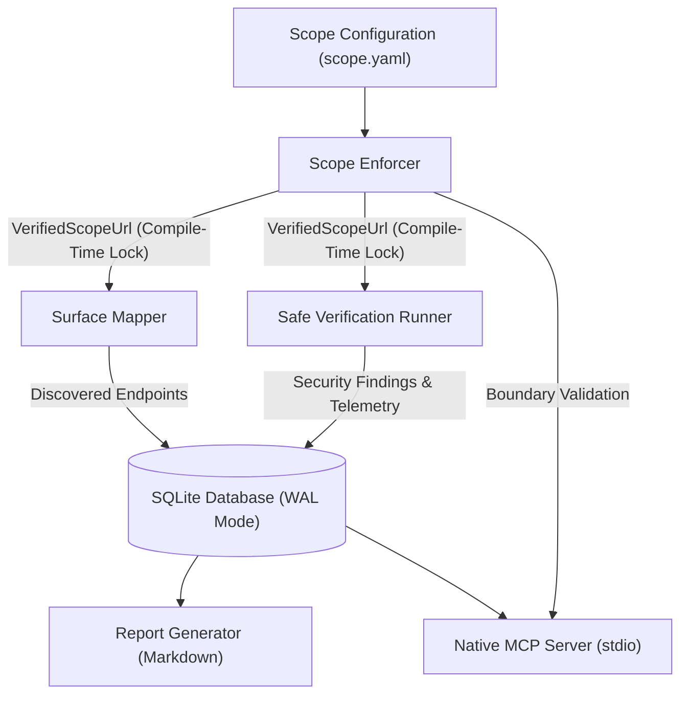

# BountyScope Consolidated Technical Reference

**Document Version:** 0.14.0  
**Specification Level:** Final Technical Reference  
**Applicability:** `bountyscope` CLI and Core Subsystems  

---

## 1. System Purpose & Foundational Invariants

BountyScope is a scope-locked reconnaissance, passive policy verification, and Model Context Protocol (MCP) triage engine written in Rust. The system is engineered specifically for authorized bug bounty assessments, vulnerability disclosure programs, and defensive security audits. It automates attack surface mapping and policy compliance evaluation while enforcing strict mathematical and compile-time boundaries to eliminate unintended traffic, denial of service conditions, or out-of-scope interactions.

### Foundational Invariants

All operations throughout BountyScope are governed by five inviolable architectural invariants:

1. **Fail-Closed Authorization:**  
   Every target domain, IP address, and URI path is treated as unauthorized until explicitly validated against the target scope specification. Any unparseable, ambiguous, or malformed URL immediately aborts execution.
2. **Compile-Time Scope Enforcement (`VerifiedScopeUrl`):**  
   The HTTP networking layer cannot accept raw string representations or unvalidated URL types. Outbound requests strictly require an unforgeable token (`VerifiedScopeUrl`) whose private constructor can only be invoked through `ScopeEnforcer::validate_url()`.
3. **Deterministic Rate and Concurrency Controls:**  
   Outbound requests are metered by an internal mutex-scheduled token bucket derived from `rate_limit_rps` (defaulting to 2 requests per second in safe mode). Concurrency is deterministic to prevent service degradation.
4. **Streamed Response Payload Ceiling (`5 MiB`):**  
   The HTTP client enforces a strict response body limit of 5 MiB (`5 * 1024 * 1024` bytes) using chunked stream consumption. Responses exceeding this threshold return `HttpError::PayloadTooLarge` while recording an audit log entry, preventing unbounded memory allocation or denial-of-service against the scanner.
5. **Non-Destructive Inspection Guarantee:**  
   The engine performs passive analysis, metadata extraction, configuration inspection, and read-only schema discovery. No mutating requests (such as state-changing POST/PUT/DELETE, credential testing, or automated fuzzing) are performed.

---

## 2. End-to-End Pipeline Architecture & Module Map

BountyScope employs a unidirectional data pipeline where each subsystem depends solely on verified upstream contracts.

### Architecture Pipeline Diagram



### Module Map

The codebase is organized into modular subsystems under `src/`:

| Module | File Path | Core Responsibilities |
|---|---|---|
| `lib` | `src/lib.rs` | Exposes public API modules, crate-level re-exports, and integration targets. |
| `main` | `src/main.rs` | CLI entry point using `clap` derive macros, environment variable fallback (`BOUNTYSCOPE_CONFIG`), default path resolution (`data/`), and pipeline command orchestration. |
| `scope` | `src/scope/mod.rs` | YAML scope parsing (`ScopeConfig`), domain/IP canonicalization, lexical path traversal normalization, wildcard DNS boundary checks, and the opaque type-state token `VerifiedScopeUrl`. |
| `http` | `src/http/mod.rs` | Transport client (`ScopedHttpClient`, `HttpProbeResponse`) configured with `Policy::none()`, mutex-driven inter-request pacing, 5 MiB response chunk limits, researcher attribution headers, and synchronous audit logging. |
| `storage` | `src/storage/mod.rs` | SQLite persistence engine (`StorageEngine`) operating with `WAL` journaling and `foreign_keys = ON`, managing relational records for programs, scope rules, endpoints, findings, and audit logs. |
| `mapper` | `src/mapper/mod.rs` | Attack surface crawler (`SurfaceMapper`) executing DOM-based HTML link/script extraction, regex-based JavaScript API route mining, technical asset discovery (`/robots.txt`), API specification discovery (`/openapi.json`), and soft-404 filtering. |
| `verifier` | `src/verifier/mod.rs` | Security policy evaluator (`SafeVerificationRunner`) checking HTML-gated headers (CSP, clickjacking), transport headers (HSTS, nosniff), CORS reflection, header disclosures, and unauthenticated AI/MCP endpoint posture. |
| `report` | `src/report/mod.rs` | Assessment report engine (`ReportGenerator`) rendering structured Markdown documents containing severity breakdown matrices, detailed finding descriptions, JSON evidence blocks, and remediation steps. |
| `mcp` | `src/mcp/mod.rs` | Native Model Context Protocol server (`BountyScopeMcpServer`) conforming to JSON-RPC 2.0 over standard I/O (`stdio`), providing declarative tools (`check_target_scope`, `list_mapped_endpoints`, `list_security_findings`, `generate_assessment_report`) with diagnostic output isolated to `stderr`. |

---

## 3. Boundary Canonicalization & Redirect Non-Following

Target scope evaluation requires strict canonicalization before boundary set comparisons.

### Canonicalization Rules

1. **FQDN Normalization:**  
   Hostnames are converted to lowercase ASCII using Punycode decoding for Internationalized Domain Names (IDN). Trailing dots representing absolute root DNS zones (e.g., `target.example.com.`) are stripped to prevent boundary bypasses (`target.example.com`).
2. **Wildcard DNS Boundaries:**  
   Wildcard domain patterns (e.g., `*.example.com`) strictly require domain component hierarchy alignment. A target `sub.api.example.com` or `api.example.com` matches, whereas prefix collisions such as `evilexample.com` or `attacker-example.com` are rejected.
3. **Private and Loopback IP Isolation:**  
   To prevent unintended Server-Side Request Forgery (SSRF) into internal networks, private IP allocations (RFC 1918: `10.0.0.0/8`, `172.16.0.0/12`, `192.168.0.0/16`), link-local allocations (RFC 3927: `169.254.0.0/16`), and loopback addresses (`127.0.0.0/8`, `::1`) are denied by default unless explicitly declared in `allowed_domains` for local testing.
4. **Lexical Path Traversal Normalization:**  
   Paths undergo recursive lexical resolution prior to exclusion checks:
   - Consecutive slashes (`//`) are collapsed into single slashes (`/`).
   - Relative directory traversal tokens (`/..`, `/./`) are resolved.
   - Percent-encoded traversal representations (such as `/%2e%2e/` or `/%2e/`) are decoded and collapsed.
   - Excluded path prefixes (e.g., `/logout`) match any normalized path starting with that prefix.

### HTTP Redirect Non-Following (`Policy::none()`)

BountyScope's HTTP transport is explicitly initialized with:
```rust
reqwest::redirect::Policy::none()
```

When a remote web server responds with an HTTP redirect status (`301 Moved Permanently`, `302 Found`, `307 Temporary Redirect`, `308 Permanent Redirect`), the client does not automatically follow the `Location` header. 

**Architectural Rationale:**  
Automatic redirect following is a common source of scope escapes in security tooling. A target host on an authorized domain could redirect requests to an out-of-scope third-party authentication provider (e.g., `auth.thirdparty.com`) or cloud metadata service (`169.254.169.254`). By terminating the request at the redirect boundary, BountyScope returns the redirect location to the caller. The destination must be passed back through `ScopeEnforcer::validate_url()` to acquire a new `VerifiedScopeUrl` before any subsequent request can be dispatched.

---

## 4. Scope Configuration Schema (`scope.yaml`)

BountyScope loads target definitions from YAML configuration files. Deserialization enforces `#[serde(deny_unknown_fields)]` to prevent undetected typos or invalid parameters.

### Schema Specification

| Field | Type | Required | Default | Description |
|---|---|---|---|---|
| `program_name` | String | Yes | - | Unique alphanumeric program identifier used for storage indexing and report headers. |
| `platform` | String | Yes | - | Origin platform (e.g., `hackerone`, `bugcrowd`, `intigriti`, `local`, `self_hosted`). |
| `allowed_domains` | List of Strings | Yes | - | Authoritative domain patterns and wildcards (`example.com`, `*.example.com`, `127.0.0.1`). |
| `excluded_domains` | List of Strings | No | `[]` | Subdomains or third-party hosts explicitly prohibited from receiving traffic. |
| `excluded_paths` | List of Strings | No | `[]` | URL path prefixes prohibited from execution (e.g., `/logout`, `/delete-account`). |
| `excluded_checks` | List of Strings | No | `[]` | Finding types suppressed from verification results (e.g., `missing_security_headers`). |
| `rate_limit_rps` | Unsigned 32-bit | No | `2` | Maximum outbound requests per second across concurrent tasks. |
| `safe_mode` | Boolean | No | `true` | Restricts operations to safe, read-only methods. |
| `researcher_handle` | String | No | `None` | If specified, injects `X-Bug-Bounty: <handle>` header into all outbound requests. |
| `policy_url` | String | No | `None` | Link to governing program policy or Safe Harbor terms recorded in reports. |

### Complete Configuration Example

```yaml
program_name: "production-bounty-program"
platform: "hackerone"

allowed_domains:
  - "example.com"
  - "*.example.com"
  - "127.0.0.1"

excluded_domains:
  - "auth.example.com"
  - "payments.example.com"
  - "status.example.com"

excluded_paths:
  - "/logout"
  - "/account/delete"
  - "/api/v1/auth/signout"
  - "/oauth/revoke"

excluded_checks:
  - "missing_security_headers"
  - "header_info_disclosure"

rate_limit_rps: 2
safe_mode: true
researcher_handle: "authorized-security-researcher"
policy_url: "https://hackerone.com/example-security-program"
```

---

## 5. SQLite Persistence Schema

All assessment artifacts, mapped surfaces, verified findings, and network logs are stored in a local SQLite database.

### Mandatory Pragmas

Upon establishing every SQLite connection, the engine executes:
```sql
PRAGMA journal_mode = WAL;
PRAGMA foreign_keys = ON;
```
- **Write-Ahead Logging (WAL):** Allows simultaneous concurrent readers without blocking active single-writer transactions.
- **Foreign Key Constraints (`ON`):** Enforces relational integrity across all tables. Child records referencing deleted programs or endpoints are automatically cascaded or set to null.

### Table Definitions & Indexes

```sql
-- 1. Program metadata
CREATE TABLE IF NOT EXISTS programs (
    id TEXT PRIMARY KEY,
    name TEXT NOT NULL UNIQUE,
    platform TEXT NOT NULL,
    policy_url TEXT,
    created_at TIMESTAMP NOT NULL DEFAULT CURRENT_TIMESTAMP,
    updated_at TIMESTAMP NOT NULL DEFAULT CURRENT_TIMESTAMP
);

-- 2. Scope boundary rules
CREATE TABLE IF NOT EXISTS scope_rules (
    id TEXT PRIMARY KEY,
    program_id TEXT NOT NULL REFERENCES programs(id) ON DELETE CASCADE,
    rule_type TEXT NOT NULL CHECK (rule_type IN ('allow_domain', 'exclude_domain', 'exclude_path')),
    pattern TEXT NOT NULL,
    created_at TIMESTAMP NOT NULL DEFAULT CURRENT_TIMESTAMP
);

-- 3. Discovered attack surface endpoints
CREATE TABLE IF NOT EXISTS endpoints (
    id TEXT PRIMARY KEY,
    program_id TEXT NOT NULL REFERENCES programs(id) ON DELETE CASCADE,
    url TEXT NOT NULL UNIQUE,
    host TEXT NOT NULL,
    path TEXT NOT NULL,
    method TEXT NOT NULL DEFAULT 'GET',
    discovered_via TEXT NOT NULL,
    status_code INTEGER,
    response_size INTEGER,
    content_type TEXT,
    created_at TIMESTAMP NOT NULL DEFAULT CURRENT_TIMESTAMP,
    last_verified_at TIMESTAMP
);

-- 4. Verified security findings
CREATE TABLE IF NOT EXISTS findings (
    id TEXT PRIMARY KEY,
    program_id TEXT NOT NULL REFERENCES programs(id) ON DELETE CASCADE,
    endpoint_id TEXT REFERENCES endpoints(id) ON DELETE SET NULL,
    finding_type TEXT NOT NULL,
    severity TEXT NOT NULL CHECK (severity IN ('INFO', 'LOW', 'MEDIUM', 'HIGH', 'CRITICAL')),
    title TEXT NOT NULL,
    description TEXT NOT NULL,
    evidence TEXT NOT NULL,
    remediation TEXT,
    verified_at TIMESTAMP NOT NULL DEFAULT CURRENT_TIMESTAMP
);

-- 5. Outbound network interaction audit log
CREATE TABLE IF NOT EXISTS audit_logs (
    id INTEGER PRIMARY KEY AUTOINCREMENT,
    program_id TEXT NOT NULL REFERENCES programs(id) ON DELETE CASCADE,
    target_url TEXT NOT NULL,
    http_method TEXT NOT NULL,
    status_code INTEGER,
    duration_ms INTEGER NOT NULL,
    rate_limited BOOLEAN NOT NULL DEFAULT 0,
    timestamp TIMESTAMP NOT NULL DEFAULT CURRENT_TIMESTAMP
);

CREATE INDEX IF NOT EXISTS idx_endpoints_host ON endpoints(host);
CREATE INDEX IF NOT EXISTS idx_findings_program ON findings(program_id);
CREATE INDEX IF NOT EXISTS idx_audit_logs_timestamp ON audit_logs(timestamp);
```

---

## 6. Security Checks, Severity Model & False-Positive Filters

### Audited Security Checks

1. **HTML-Only Header Auditing:**  
   Browser-enforced defense-in-depth controls are evaluated strictly against responses where the `Content-Type` header contains `text/html`:
   - `Content-Security-Policy`: Missing header (`missing_security_headers`) or permissive directives containing `'unsafe-inline'` or `'unsafe-eval'` (`weak_csp`).
   - Clickjacking Protection: Absence of both CSP `frame-ancestors` and valid `X-Frame-Options` (`DENY` or `SAMEORIGIN`) (`missing_security_headers`).
2. **General Security Headers:**  
   Evaluated across all responses:
   - `X-Content-Type-Options`: Missing `nosniff` (`missing_security_headers`).
   - `Strict-Transport-Security`: Missing HSTS on HTTPS endpoints (`missing_security_headers`).
3. **Technology & Banner Information Disclosure:**  
   Identifies backend framework disclosure (`X-Powered-By`) and verbose software version banners (`Server: Apache/2.4.52`) containing numeric digits (`header_info_disclosure`).
4. **Cross-Origin Resource Sharing (CORS) Policy:**  
   Tests endpoints with `Origin: https://untrusted.example.invalid` and `Origin: null`:
   - Dynamic reflection of untrusted origin with `Access-Control-Allow-Credentials: true` (`cors_misconfiguration`, `HIGH`).
   - Dynamic reflection of untrusted origin without credentials (`cors_misconfiguration`, `MEDIUM`).
   - Reflection of `null` origin with credentials (`cors_misconfiguration`, `HIGH`).
   - Static asset files (`.woff`, `.woff2`, `.css`, `.png`, `.jpg`, `.svg`) are exempted from CORS findings.
5. **Exposed API Specifications:**  
   Probes `/openapi.json`, `/swagger.json`, `/v3/api-docs`. Validates JSON/YAML syntax and required OpenAPI root keys, rejecting HTML soft-404 responses (`exposed_api_spec`, `INFO`).
6. **Unauthenticated AI & MCP Interfaces:**  
   Detects endpoints matching `/sse`, `/messages`, `/mcp`, `/v1/models` that return HTTP 200 without presenting a `WWW-Authenticate` challenge or requiring authentication tokens (`unauthenticated_ai_endpoint`, `HIGH`).

### Severity Classification Matrix

| Severity | Definition | Applicable Finding Types |
|---|---|---|
| **CRITICAL** | Direct privilege escalation, remote code execution, or unrestricted data exfiltration without credentials. | Confirmed state takeover, unauthenticated administrative MCP invocation. |
| **HIGH** | Significant access boundary failure or credentialed cross-origin read. | `cors_misconfiguration` (with credentials), `unauthenticated_ai_endpoint`. |
| **MEDIUM** | Uncredentialed cross-origin access or exploitable defense weakness. | `cors_misconfiguration` (uncredentialed arbitrary origin reflection). |
| **LOW** | Missing browser-enforced isolation header or weakened CSP. | `missing_security_headers` (CSP, XFO, XCTO, HSTS), `weak_csp`. |
| **INFO** | Defensive telemetry, software banner disclosures, or public API specifications. | `exposed_api_spec`, `header_info_disclosure`. |

### Deterministic False-Positive Filters

- **MIME / Content-Type Filtering:** Probes targeting API documentation or JSON endpoints must return matching MIME types. HTML error pages returning HTTP 200 are discarded.
- **Static Asset Exemption:** Static assets matching image, font, and stylesheet extensions are ignored by CORS auditing because open resource sharing is standard browser behavior.
- **Legacy Header Deduplication:** If `Content-Security-Policy` defines `frame-ancestors`, missing `X-Frame-Options` is not flagged as a vulnerability.
- **Rate-Limit Backoff Isolation:** HTTP 429 and 503 challenge responses are excluded from security findings to prevent evaluating WAF/CDN challenge pages as application logic.
- **Configured Rule Suppression:** Any finding matching an entry in `excluded_checks` is dropped prior to database persistence and omitted from summary metrics.

---

## 7. CLI Subcommands, Ergonomics & MCP Server

### Ergonomics & Default Resolution

- **Environment Variable Fallback:** All subcommands accept `BOUNTYSCOPE_CONFIG` as a fallback when `--config` is omitted.
- **Deterministic Database Path:** When `--db` is omitted, BountyScope derives `data/<sanitized_program_name>.db` (sanitizing non-alphanumeric characters to `_`) and automatically creates parent directories via `std::fs::create_dir_all`.
- **Deterministic Report Path:** When `--output` is omitted, `report` and `scan` default to `data/<sanitized_program_name>_report.md`. A `--stdout` flag is available on `report` for pipeline redirection.

### Subcommand Reference

```bash
# 1. Validate scope YAML configuration
bountyscope validate-scope [--config <path>]

# 2. Unified assessment scan (map -> audit -> report)
bountyscope scan --url <seed_url> [--config <path>] [--db <path>] [--output <file.md>]

# 3. Probe single target endpoint
bountyscope probe --url <target_url> [--config <path>] [--db <path>]

# 4. Passively map surface from seed URL
bountyscope map --url <seed_url> [--config <path>] [--db <path>]

# 5. Audit security posture of mapped endpoints
bountyscope audit [--config <path>] [--db <path>]

# 6. Generate Markdown assessment report
bountyscope report [--config <path>] [--db <path>] [--output <file.md>] [--stdout]

# 7. Start Model Context Protocol (MCP) server
bountyscope mcp [--config <path>] [--db <path>]
```

### Native Model Context Protocol (MCP) Server

The MCP server implements JSON-RPC 2.0 over standard I/O streams (`stdio`) via `rmcp`:
- **`stdout` Protocol Isolation:** Standard output is strictly reserved for newline-delimited JSON-RPC 2.0 messages. Any unexpected write to stdout invalidates protocol framing.
- **`stderr` Diagnostics:** All tracing events, operational diagnostics, and error messages are routed exclusively to standard error.

**Exposed MCP Tools:**
1. `check_target_scope`: Evaluates whether a URL falls within authorized boundaries (`{"allowed": bool, "normalized_url": Option<String>, "reason": Option<String>}`).
2. `list_mapped_endpoints`: Returns paginated lists of discovered endpoints for the active program.
3. `list_security_findings`: Returns security findings filtered optionally by minimum severity (`CRITICAL`, `HIGH`, `MEDIUM`, `LOW`, `INFO`).
4. `generate_assessment_report`: Compiles and returns the complete Markdown assessment report.

---

## 8. Offline Local Docker Lab Workflow

BountyScope includes a self-contained offline testing lab located in `lab/` to verify scanning and mapping without generating external internet traffic.

### Architecture & Isolation

The lab runs two containerized services via Docker Compose:
- **OWASP Juice Shop (`127.0.0.1:3000`):** Simulates complex single-page applications, client-side JavaScript bundles, and RESTful APIs.
- **Mock API Service (`127.0.0.1:8080`):** Simulates OpenAPI specifications, customized `robots.txt` rules, and configurable HTTP headers.
- **Loopback Invariant:** All port bindings are bound strictly to `127.0.0.1`. Under no circumstances are ports published to `0.0.0.0`.

### Execution Workflow

```bash
# 1. Start lab containers in detached mode
cd lab
docker compose up -d

# 2. Verify container status
docker compose ps

# 3. Validate loopback scope configuration
cd ..
bountyscope validate-scope --config configs/scope.local.yaml

# 4. Run unified scan against local lab mock service
bountyscope scan --config configs/scope.local.yaml --url http://127.0.0.1:8080/

# 5. Or execute granular workflow
bountyscope map --config configs/scope.local.yaml --url http://127.0.0.1:8080/
bountyscope audit --config configs/scope.local.yaml
bountyscope report --config configs/scope.local.yaml --stdout

# 6. Stop lab environment when complete
cd lab
docker compose down
```
