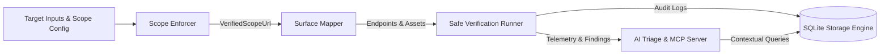

# BountyScope

**Version:** 0.14.0  
**License:** MIT or Apache-2.0  

BountyScope is an automated vulnerability surface mapping and passive policy verification engine designed for authorized bug bounty assessments and defensive security reviews. The system enforces strict scope boundaries, deterministic rate limiting, and compile-time target guarantees to ensure all discovery and verification actions remain within defined rules of engagement.

---

## Key Capabilities

- **Compile-Time Scope Enforcement:** Prevents unintended network calls by enforcing the `VerifiedScopeUrl` type invariant on internal HTTP clients.
- **Strict Scope Configuration & RoE Attribution:** Validates domains, wildcard subdomains, negative path exclusions, researcher handles (`X-Bug-Bounty` attribution), governing policy URLs, and program check exclusions (`excluded_checks`).
- **Scope-Locked HTTP Client:** Outbound dispatcher strictly rejecting automatic redirects, enforcing rate limits, attaching attribution headers, and recording full audit trails.
- **Embedded SQLite Storage:** Local persistence for scope definitions, mapped endpoints, and outbound interaction audit logs with WAL mode and foreign key enforcement.
- **Surface Mapping:** Discovers endpoints from HTML structures, scripts, and standard metadata specifications without intrusive probing.
- **Passive Policy Auditing:** Evaluates HTTP security headers, Cross-Origin Resource Sharing (CORS) configurations, and exposed OpenAPI/Swagger documentation.
- **Isolated Local Test Environment:** Includes an offline Ubuntu Docker lab binding services strictly to loopback (`127.0.0.1`) for safe test execution.

---

## Architecture Overview



1. **Scope Enforcer (`src/scope`):** Perimeter gateway enforcing domain, wildcard, and path boundaries, producing `VerifiedScopeUrl`.
2. **Storage Engine (`src/storage`):** Thread-safe SQLite persistence layer enforcing WAL journal mode and foreign key integrity.
3. **Scoped HTTP Client (`src/http`):** Scope-locked network dispatcher enforcing rate limiting and non-automatic redirect handling.
4. **Surface Mapper:** Passive endpoint and asset extraction engine.
5. **Safe Verification Runner:** Non-destructive policy and configuration auditor.
6. **AI Triage & MCP Server:** Model Context Protocol interface exposing structured findings and contextual scope queries.

For detailed technical documentation, refer to the [Doc/](file:///home/stringray/BountyScope/Doc) directory:
- [01_SYSTEM_OVERVIEW.md](file:///home/stringray/BountyScope/Doc/01_SYSTEM_OVERVIEW.md)
- [02_ARCHITECTURE.md](file:///home/stringray/BountyScope/Doc/02_ARCHITECTURE.md)
- [03_SECURITY_CHECKS.md](file:///home/stringray/BountyScope/Doc/03_SECURITY_CHECKS.md)
- [04_LOCAL_LAB_GUIDE.md](file:///home/stringray/BountyScope/Doc/04_LOCAL_LAB_GUIDE.md)

---

## Safety Invariants

- **Compile-Time Scope Lock:** Outbound HTTP clients accept only `VerifiedScopeUrl` instances. Raw strings or unchecked URLs are rejected at compile time.
- **No Automatic Redirect Following:** HTTP 301/302/307/308 redirects are never followed implicitly. The `Location` header is captured in response metadata and must be re-validated through `ScopeEnforcer`.
- **Zero Panics in Runtime Paths:** All error states are handled via structured error types (`thiserror` and `anyhow`). Runtime code contains zero calls to `.unwrap()`, `.expect()`, or `panic!()`.
- **Zero Unsafe Code:** The entire codebase operates strictly under safe Rust without `unsafe` blocks.
- **Rate-Limiting & Safe Mode:** Default request rates do not exceed 2 requests per second unless explicitly configured. Destructive payloads, brute-force loops, and denial-of-service behaviors are strictly prohibited.

---

## Prerequisites

- **Rust:** 1.80+ (2021 or 2024 edition) with `cargo`
- **C Compiler & Toolchain:** `gcc` or `clang`, `pkg-config`
- **Valgrind:** 3.18+ (for deterministic memory leak verification)
- **Docker Compose:** (optional, for running the local offline test lab)

---

## Installation & Build

Clone the repository and build using Cargo:

```bash
cargo build --release
```

Run test suites and memory verification:

```bash
# Run unit and integration tests
cargo test

# Check code formatting and lints
cargo fmt --check
cargo clippy --all-targets --all-features -- -D warnings
```

---

## CLI Usage

### Version Inspection

```bash
bountyscope --version
```

### Validate Target Scope Configuration

Validate target boundary rules against the scope schema:

```bash
bountyscope validate-scope --config configs/scope.example.yaml
```

Sample output:
```text
Scope configuration valid: example-security-program (platform: hackerone, allowed_domains: 3, excluded_domains: 3, excluded_paths: 4, rate_limit_rps: 2, safe_mode: true)
```

### Safely Probe Target URL

Validate a target URL against scope rules, dispatch a single safe GET request, and record the interaction in SQLite:

```bash
bountyscope probe --config configs/scope.example.yaml --url http://127.0.0.1:8080/openapi.json --db data/bountyscope.db
```

Sample output:
```text
Probe successful: http://127.0.0.1:8080/openapi.json -> HTTP 200 (application/json, 538 bytes, 3 ms)
```

### Passively Map Attack Surface

Initiate passive surface mapping from an in-scope seed URL:

```bash
bountyscope map --config configs/scope.example.yaml --url http://127.0.0.1:8080/ --db data/bountyscope.db
```

Sample output:
```text
Surface mapping complete for http://127.0.0.1:8080/: 14 endpoints discovered (9 in-scope, 5 out-of-scope discarded)
  [seed] http://127.0.0.1:8080/ (HTTP 200)
  [html_link] http://127.0.0.1:8080/dashboard (unprobed)
  [html_script] http://127.0.0.1:8080/static/app.js (HTTP 200)
  [js_route] http://127.0.0.1:8080/api/v1/users (unprobed)
  [js_route] http://127.0.0.1:8080/api/v2/metrics (unprobed)
  [js_route] http://127.0.0.1:8080/graphql (unprobed)
  [robots_txt] http://127.0.0.1:8080/robots.txt (HTTP 200)
  [robots_txt] http://127.0.0.1:8080/admin (unprobed)
  [openapi_spec] http://127.0.0.1:8080/openapi.json (HTTP 200)
```

### Audit Mapped Endpoints

Execute safe, non-destructive policy and configuration checks across mapped endpoints:

```bash
bountyscope audit --config configs/scope.example.yaml --db data/bountyscope.db
```

Sample output:
```text
Audit completed for program 'example-security-program': 9 endpoints audited, 6 total findings
  CRITICAL: 0
  HIGH:     1
  MEDIUM:   1
  LOW:      3
  INFO:     1
```

### Generate Assessment Markdown Report

Render assessment findings, severity breakdowns, and remediation guidance into Markdown:

```bash
# Export to a Markdown report file
bountyscope report --config configs/scope.example.yaml --db data/bountyscope.db --output report.md

# Print directly to standard output
bountyscope report --config configs/scope.example.yaml --db data/bountyscope.db
```

---

## Local Testing Lab

An offline local testing lab is available in `lab/` featuring OWASP Juice Shop and a mock API server bound strictly to loopback (`127.0.0.1`):

```bash
cd lab
docker compose up -d
bountyscope validate-scope --config configs/scope.example.yaml
bountyscope probe --config configs/scope.example.yaml --url http://127.0.0.1:8080/openapi.json --db data/bountyscope.db
docker compose down
```

See [Doc/04_LOCAL_LAB_GUIDE.md](file:///home/stringray/BountyScope/Doc/04_LOCAL_LAB_GUIDE.md) for full instructions.
