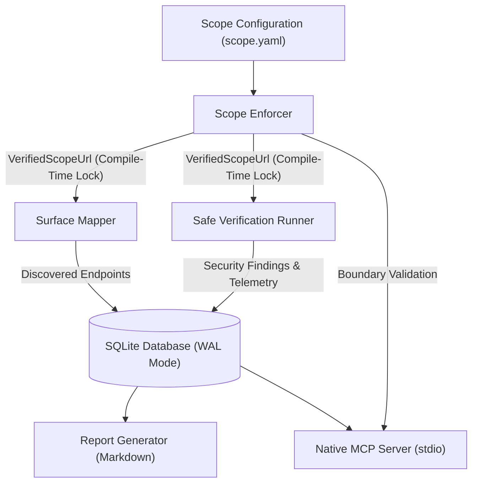

# BountyScope

[](Cargo.toml)
[](https://github.com/Rohinthan/BountyScope/actions/workflows/ci.yml)
[](LICENSE)
[](https://m8ven.ai/mcp/rohinthan-bountyscope-ewsupe?s=readme)

BountyScope is a scope-locked reconnaissance, passive policy auditing, and Model Context Protocol (MCP) triage command-line interface written in Rust. It is engineered for authorized bug bounty programs, defensive security reviews, and vulnerability disclosure assessments. The system guarantees strict scope boundaries, non-destructive policy evaluation, deterministic rate limiting, and compile-time target verification before executing any network interactions.

---

## Core Safety Guarantees

BountyScope enforces five architectural invariants across all discovery and audit flows:

1. **Compile-Time Scope Enforcement (`VerifiedScopeUrl`):**
   Outbound HTTP clients within the engine strictly require a `VerifiedScopeUrl` token as their target parameter. Because `VerifiedScopeUrl` has a private constructor that can only be minted by `ScopeEnforcer::validate_url()`, raw strings or unvalidated URLs cannot be dispatched across the network, eliminating scope escapes at compile time.

2. **Path-Traversal and FQDN Normalization:**
   Target URLs and candidate endpoints undergo strict canonicalization prior to boundary checks. The enforcer normalizes duplicate slashes (`//`), directory traversal sequences (`/..`, `/%2e%2e/`), and trailing domain dots (`example.com.` -> `example.com`), while matching wildcard DNS boundaries (`*.example.com`) against public suffix rules.

3. **Socket-Level DNS IP Guard (`ScopeAwareDnsResolver`):**
   Outbound network connections install a custom DNS resolver implementing `reqwest::dns::Resolve` that intercepts resolution right before TCP socket creation. The resolver inspects every resolved `SocketAddr` (including IPv4-mapped IPv6) and rejects loopback (`127.0.0.0/8`, `::1`), RFC 1918 private (`10.0.0.0/8`, `172.16.0.0/12`, `192.168.0.0/16`), link-local (`169.254.0.0/16`, `fe80::/10`), CGNAT (`100.64.0.0/10`), and unspecified IPs unless that exact IP or loopback host was explicitly allowlisted in `scope.yaml`, eliminating DNS rebinding and internal SSRF risks.

4. **Deterministic Rate Limiting, Non-Redirecting Transport & Payload Ceiling:**
   The network transport layer is configured with `reqwest::redirect::Policy::none()`, preventing automatic redirect following (HTTP 301/302/307/308) into unverified domains. Inter-request pacing is governed deterministically by `rate_limit_rps` (defaulting to 2 requests per second in safe mode), and streamed responses are constrained to a strict 5 MiB (`MAX_RESPONSE_BODY_BYTES`) ceiling to prevent unbounded memory consumption.

5. **Stdio JSON-RPC 2.0 Framing Isolation:**
   When running the native Model Context Protocol (MCP) server, all tracing, diagnostic logging, and error output are routed strictly to standard error (`stderr`). Standard output (`stdout`) is preserved exclusively for newline-delimited JSON-RPC 2.0 frames, preventing transport protocol corruption.

---

## Architecture Pipeline

The following diagram illustrates the unidirectional data pipeline from configuration loading through scope enforcement, surface mapping, verification, and MCP serving:



---

## Installation & Cross-Platform Support

`BountyScope` compiles natively on **Linux**, **macOS**, and **Windows** using `rustls` and bundled SQLite (`rusqlite`), requiring no external OpenSSL or system SQLite runtime libraries.

### Platform Support

| Operating System | Architecture | Default Binary Location |
| :--- | :--- | :--- |
| **Linux** (Ubuntu, Debian, Fedora, Arch) | `x86_64`, `aarch64` | `~/.cargo/bin/bountyscope` |
| **macOS** (Apple Silicon & Intel) | `aarch64`, `x86_64` | `~/.cargo/bin/bountyscope` |
| **Windows** (Windows 10 / 11) | `x86_64`, `aarch64` | `%USERPROFILE%\.cargo\bin\bountyscope.exe` |

### Prerequisites

- **Rust Toolchain:** Rust 1.80+ (2021 edition) with `cargo` (`curl --proto '=https' --tlsv1.2 -sSf https://sh.rustup.rs | sh`)
- **Git**
- **Docker Compose:** (optional, required only for running the offline local lab)

### Installation & Verification

#### Option 1: Download Pre-Built Binaries (GitHub Releases)

Pre-compiled, statically linked release archives and SHA-256 checksums are published for Linux, macOS, and Windows on every release at [GitHub Releases](https://github.com/Rohinthan/BountyScope/releases):

| Operating System | Target Triple | Archive File | Verification Command |
| :--- | :--- | :--- | :--- |
| **Linux (x86_64)** | `x86_64-unknown-linux-gnu` | `bountyscope-v0.16.0-linux-x86_64.tar.gz` | `sha256sum -c bountyscope-v0.16.0-linux-x86_64.tar.gz.sha256` |
| **macOS (Apple Silicon)** | `aarch64-apple-darwin` | `bountyscope-v0.16.0-macos-aarch64.tar.gz` | `shasum -a 256 -c bountyscope-v0.16.0-macos-aarch64.tar.gz.sha256` |
| **macOS (Intel)** | `x86_64-apple-darwin` | `bountyscope-v0.16.0-macos-x86_64.tar.gz` | `shasum -a 256 -c bountyscope-v0.16.0-macos-x86_64.tar.gz.sha256` |
| **Windows (x86_64)** | `x86_64-pc-windows-msvc` | `bountyscope-v0.16.0-windows-x86_64.zip` | `Get-FileHash -Algorithm SHA256 bountyscope-v0.16.0-windows-x86_64.zip` |

##### Linux / macOS Quick Download & Verification

```bash
VERSION="0.16.0"
PLATFORM="linux-x86_64" # or "macos-aarch64" / "macos-x86_64"

# Download distribution archive and checksum
curl -LO "https://github.com/Rohinthan/BountyScope/releases/download/v${VERSION}/bountyscope-v${VERSION}-${PLATFORM}.tar.gz"
curl -LO "https://github.com/Rohinthan/BountyScope/releases/download/v${VERSION}/bountyscope-v${VERSION}-${PLATFORM}.tar.gz.sha256"

# Verify SHA-256 checksum
sha256sum -c "bountyscope-v${VERSION}-${PLATFORM}.tar.gz.sha256" || shasum -a 256 -c "bountyscope-v${VERSION}-${PLATFORM}.tar.gz.sha256"

# Extract and install binary to ~/.cargo/bin or /usr/local/bin
tar -xzf "bountyscope-v${VERSION}-${PLATFORM}.tar.gz"
mkdir -p ~/.cargo/bin
mv bountyscope ~/.cargo/bin/
```

##### Windows (PowerShell) Quick Download & Verification

```powershell
$version = "0.16.0"

# Download archive and checksum
Invoke-WebRequest -Uri "https://github.com/Rohinthan/BountyScope/releases/download/v$version/bountyscope-v$version-windows-x86_64.zip" -OutFile "bountyscope-v$version-windows-x86_64.zip"
Invoke-WebRequest -Uri "https://github.com/Rohinthan/BountyScope/releases/download/v$version/bountyscope-v$version-windows-x86_64.zip.sha256" -OutFile "bountyscope-v$version-windows-x86_64.zip.sha256"

# Verify SHA-256 hash
Get-FileHash -Algorithm SHA256 "bountyscope-v$version-windows-x86_64.zip"

# Extract archive
Expand-Archive -Path "bountyscope-v$version-windows-x86_64.zip" -DestinationPath "$HOME\.cargo\bin" -Force
```

#### Option 2: Build and Install from Source (`cargo`)

##### Linux & macOS (bash / zsh)

```bash
# Clone repository
git clone https://github.com/Rohinthan/BountyScope.git
cd BountyScope

# Build and install release binary to ~/.cargo/bin
cargo install --path .

# Verify installation
export BOUNTYSCOPE_CONFIG="configs/scope.example.yaml"
bountyscope validate-scope
```

##### Windows (PowerShell)

```powershell
# Clone repository
git clone https://github.com/Rohinthan/BountyScope.git
cd BountyScope

# Build and install release binary to %USERPROFILE%\.cargo\bin
cargo install --path .

# Verify installation
$env:BOUNTYSCOPE_CONFIG = "configs\scope.example.yaml"
bountyscope validate-scope
```

### Quality and Verification Checks

```bash
# Verify code formatting
cargo fmt --check

# Run static analysis and lints
cargo clippy --all-targets --all-features -- -D warnings

# Execute test suite
cargo test
```

---

## Quick Start: Run Straight in Terminal

Copy and paste these four blocks directly into your terminal to test `BountyScope` end-to-end against a local sample webpage without manually editing files.

### Step 1: Create and Start a Sample Web Server

In a separate terminal tab, create a sample `index.html` and start Python's built-in server on `127.0.0.1:8080`:

```bash
mkdir -p ~/sample-target && cd ~/sample-target

cat << 'EOF' > index.html
<!DOCTYPE html>
<html>
<head>
    <title>Sample Target Application</title>
</head>
<body>
    <h1>Local Test Webpage</h1>
    <nav>
        <a href="/dashboard">User Dashboard</a>
        <a href="/api/v1/users">API Users</a>
        <a href="/openapi.json">API Documentation</a>
    </nav>
    <script>
        const API_ROUTE = "/api/v2/telemetry";
    </script>
</body>
</html>
EOF

python3 -m http.server 8080 --bind 127.0.0.1
```

### Step 2: Define Target Scope (`data/scope.local.yaml`)

In your BountyScope repository root, create `data/scope.local.yaml` (placed inside `data/` to ensure it is automatically ignored by Git):

```bash
mkdir -p data

cat << 'EOF' > data/scope.local.yaml
program_name: "local-sample-target"
platform: "local"

allowed_domains:
  - "127.0.0.1"
  - "localhost"

excluded_domains: []
excluded_paths:
  - "/logout"

rate_limit_rps: 5
safe_mode: true
EOF

bountyscope validate-scope --config data/scope.local.yaml
```

### Step 3: Run the Unified Scan

Map the surface, audit response headers, save to SQLite (`data/local_sample_target.db`), and export the Markdown report (`data/local_sample_target_report.md`) in one command:

```bash
bountyscope scan --config data/scope.local.yaml --url http://127.0.0.1:8080/
```

### Step 4: View the Generated Report

```bash
cat data/local_sample_target_report.md
```

---

## Configuration Reference (`scope.yaml`)

BountyScope requires a YAML configuration file defining the program boundaries and Rules of Engagement (RoE).

### Configuration Schema

| Field | Type | Required | Description |
|---|---|---|---|
| `program_name` | String | Yes | Unique program identifier. |
| `platform` | String | Yes | Vulnerability disclosure platform (e.g., `hackerone`, `bugcrowd`, `intigriti`, `self_hosted`). |
| `allowed_domains` | List of Strings | Yes | Authorized domain patterns and wildcard expressions (e.g., `example.com`, `*.example.com`). |
| `excluded_domains` | List of Strings | No | Subdomains or third-party hosts explicitly excluded from testing. |
| `excluded_paths` | List of Strings | No | URL path prefixes explicitly excluded (e.g., `/logout`, `/admin/delete`). |
| `excluded_checks` | List of Strings | No | Finding types to skip during audits (e.g., `missing_security_headers`). |
| `rate_limit_rps` | Integer | No | Maximum outbound requests per second (default: `2`). |
| `safe_mode` | Boolean | No | Enforces safe read-only testing defaults (default: `true`). |
| `researcher_handle` | String | No | Attaches `X-Bug-Bounty: <handle>` header to outbound HTTP requests for attribution. |
| `policy_url` | String | No | URL to the governing bug bounty policy or Safe Harbor terms. |

### Example Configuration (`configs/scope.example.yaml`)

```yaml
program_name: "example-security-program"
platform: "hackerone"
allowed_domains:
  - "example.com"
  - "*.example.com"
  - "127.0.0.1"

excluded_domains:
  - "auth.example.com"
  - "payments.example.com"
  - "status.example.com"

excluded_paths:
  - "/logout"
  - "/oauth/revoke"
  - "/account/delete"
  - "/api/v1/auth/signout"

excluded_checks:
  - "missing_security_headers"

rate_limit_rps: 2
safe_mode: true
researcher_handle: "security-researcher"
policy_url: "https://hackerone.com/example-security-program"
```

---

## CLI Command Reference

BountyScope provides a suite of subcommands for validation, passive mapping, verification, reporting, and MCP integration.

### Environment Variable Fallback (`BOUNTYSCOPE_CONFIG`)

All subcommands accept the `BOUNTYSCOPE_CONFIG` environment variable as a fallback for the `--config` parameter:

```bash
export BOUNTYSCOPE_CONFIG="configs/scope.example.yaml"
```

When set, the `--config` flag can be omitted from any command invocation.

### Automatic Database and Report Path Derivation

The `--db` parameter is optional across all commands. When omitted, BountyScope automatically derives a deterministic database path at `data/<sanitized_program_name>.db` and creates parent directories automatically.

Similarly, `--output` on `report` and `scan` defaults to `data/<sanitized_program_name>_report.md`. To print reports directly to standard output, pass the `--stdout` flag to `report`.

### Command Matrix

| Command | Purpose | Input Flags | Output |
|---|---|---|---|
| `validate-scope` | Verifies YAML syntax, scope boundary integrity, and strict safety guardrails. | `[--config]`, `[--strict]`, `[--json]` | Console validation summary or structured JSON diagnostics |
| `scan` | Unified pipeline: maps surface, audits endpoints, and exports report. | `--url`, `[--config]`, `[--db]`, `[--output]`, `[--format]`, `[--enable-ct]` | SQLite database and Assessment report (`md`, `json`, `sarif`) |
| `probe` | Safely evaluates and probes a single in-scope URL. | `--url`, `[--config]`, `[--db]` | HTTP status, headers, audit log entry |
| `map` | Passively extracts links, scripts, source maps, sitemaps, security policies, and API specs from a seed URL. | `--url`, `[--config]`, `[--db]`, `[--enable-ct]` | Discovered endpoints in SQLite |
| `ct` | Passively discovers in-scope subdomains via public Certificate Transparency logs (`crt.sh`). | `[--config]`, `[--json]`, `[--db]` | Discovered subdomains in console or JSON |
| `audit` | Evaluates HTTP headers, CORS policies, and spec disclosures. | `[--config]`, `[--db]` | Audit findings summary |
| `report` | Generates assessment reports in Markdown, JSON, or OASIS SARIF v2.1.0 format. | `[--config]`, `[--db]`, `[--output]`, `[--stdout]`, `[--format]` | Assessment report (`md`, `json`, or `sarif`) |
| `diff` | Compares historical scan snapshots to identify regressions, status transitions, and surface deltas. | `[--config]`, `[--db]`, `[--from]`, `[--to]`, `[--output]`, `[--stdout]`, `[--format]` | Diff report (`md` or `json`) |
| `mcp` | Launches the Model Context Protocol server over standard I/O (`stdio`). | `[--config]`, `[--db]` | JSON-RPC 2.0 protocol on stdout |

### Lifecycle & State Modifications (What Changes on Each Run)

Understanding the exact network, database, and filesystem modifications executed by each command:

| Command | Network Activity | SQLite Database Changes | Filesystem Changes | Idempotency on Re-running |
|---|---|---|---|---|
| `validate-scope` | **Zero requests** (Offline) | **None** | **None** | Completely safe; validates syntax and exits. |
| `scan` | Sends rate-limited GET requests to discover and audit endpoints | Populates and updates `programs`, `scope_rules`, `endpoints`, `findings`, and `audit_logs` | Creates/updates `data/<program>.db` and writes `data/<program>_report.md` | Re-running refreshes existing records and updates timestamps without duplicating rows. |
| `probe` | Sends exactly **1 HTTP GET request** to the target URL | Appends a single row to the `audit_logs` table | Creates parent `data/` directory and database file if not already present | Safe to re-run; appends an additional audit log record with new latency and timestamp. |
| `map` | Sends rate-limited GET requests to crawl HTML links, script tags, routes, and `robots.txt` | Upserts discovered URLs into `endpoints`; appends each request to `audit_logs` | Creates/updates `data/<program>.db` | Re-running updates `last_verified_at` timestamps on existing endpoints without creating duplicate rows. |
| `ct` | Sends passive GET request to public CT log (`crt.sh`) for eligible base domains | Upserts discovered in-scope hostnames into `endpoints` table | Creates/updates `data/<program>.db` | Completely idempotent; skips out-of-scope SANs and updates existing endpoints. |
| `audit` | Sends non-destructive GET requests with audit test headers (CORS origins, spec paths) | Upserts policy violations into `findings`; appends each check to `audit_logs` | Updates `data/<program>.db` | Re-running updates existing finding evidence in place; does not multiply finding counts. |
| `report` | **Zero requests** (Offline) | **None** (Read-only query of existing records) | Writes or updates `data/<program>_report.md` (or prints to terminal if `--stdout` is set) | Completely idempotent; reconstructs the report directly from current database state. |
| `diff` | **Zero requests** (Offline) | **None** (Read-only query of historical snapshots) | Writes `data/<program>_diff.md` (or prints to terminal if `--stdout` is set) | Completely idempotent; compares historical snapshot runs without mutating database. |
| `mcp` | Zero autonomous requests (Queries driven by connected AI assistant) | Reads `endpoints` and `findings`; evaluates scope boundaries via `ScopeEnforcer` | **None** (Communicates over stdio JSON-RPC 2.0) | Continuous streaming process. |

#### Idempotency Invariant

BountyScope enforces database idempotency across all commands. The storage engine uses SQLite unique constraints (`ON CONFLICT(url) DO UPDATE` for endpoints and `ON CONFLICT(program_id, endpoint_id, finding_type) DO UPDATE` for findings). Running `map`, `audit`, or `scan` multiple times against the same target will refresh verification timestamps and update evidence rather than bloating your database with redundant duplicate entries.

### 1. Unified Assessment Scan (`bountyscope scan`)

Execute surface mapping, passive policy verification, and Markdown report export in a single command:

```bash
# Unified scan with explicit configuration
bountyscope scan --url http://127.0.0.1:8080/ --config configs/scope.example.yaml

# Unified scan using BOUNTYSCOPE_CONFIG and automatic path derivation
export BOUNTYSCOPE_CONFIG=configs/scope.example.yaml
bountyscope scan --url http://127.0.0.1:8080/
```

Sample output:
```text
Target scope initialized for program 'example-security-program'
Database: "data/example_security_program.db"
Starting passive surface mapping from http://127.0.0.1:8080/...
Surface mapping complete: 14 endpoints discovered (9 in-scope, 5 out-of-scope discarded)
Starting non-destructive security verification...
Audit completed: 9 endpoints audited, 6 total findings
  CRITICAL: 0
  HIGH:     1
  MEDIUM:   1
  LOW:      3
  INFO:     1
Assessment report generated successfully: "data/example_security_program_report.md"
```

### 2. Validate Scope Configuration

Standard syntax and boundary check:
```bash
bountyscope validate-scope --config configs/scope.example.yaml
```

Sample output:
```text
Scope configuration valid: example-security-program (platform: hackerone, allowed_domains: 3, excluded_domains: 3, excluded_paths: 7, rate_limit_rps: 2, safe_mode: true)
```

Enforce strict safety guardrails (`--strict`) to catch broad wildcards, unapproved raw IPs, and missing sensitive path exclusions:
```bash
bountyscope validate-scope --config configs/scope.local.yaml --strict
```

Sample output:
```text
Scope configuration valid (strict): local-lab-verification (platform: local, allowed_domains: 2, excluded_domains: 0, excluded_paths: 5, rate_limit_rps: 5, safe_mode: true)
```

Output structured machine-readable diagnostics (`--json`):
```bash
bountyscope validate-scope --config configs/scope.local.yaml --strict --json
```

Sample output:
```json
{
  "valid": true,
  "strict": true,
  "config_path": "configs/scope.local.yaml",
  "program_name": "local-lab-verification",
  "platform": "local",
  "errors": [],
  "warnings": []
}
```

### 3. Safely Probe Target Endpoint

```bash
# Database automatically defaults to data/example_security_program.db
bountyscope probe --config configs/scope.example.yaml --url http://127.0.0.1:8080/openapi.json
```

Sample output:
```text
Probe successful: http://127.0.0.1:8080/openapi.json -> HTTP 200 (application/json, 538 bytes, 3 ms)
```

### 4. Passively Map Attack Surface

```bash
bountyscope map --config configs/scope.example.yaml --url http://127.0.0.1:8080/
```

Sample output:
```text
Surface mapping complete for http://127.0.0.1:8080/: 18 endpoints discovered (13 in-scope, 5 out-of-scope discarded)
  [seed] http://127.0.0.1:8080/ (HTTP 200)
  [html_link] http://127.0.0.1:8080/dashboard (unprobed)
  [html_script] http://127.0.0.1:8080/static/app.js (HTTP 200)
  [js_route] http://127.0.0.1:8080/api/v1/users (unprobed)
  [js_route] http://127.0.0.1:8080/api/v2/metrics (unprobed)
  [js_route] http://127.0.0.1:8080/graphql (unprobed)
  [js_subdomain] https://api.example.com/v1/telemetry (unprobed)
  [source_map] http://127.0.0.1:8080/static/app.js.map (HTTP 200)
  [source_map] http://127.0.0.1:8080/api/v2/internal-metrics (unprobed)
  [robots_txt] http://127.0.0.1:8080/robots.txt (HTTP 200)
  [robots_txt] http://127.0.0.1:8080/admin (unprobed)
  [sitemap_xml] http://127.0.0.1:8080/sitemap.xml (HTTP 200)
  [sitemap_xml] http://127.0.0.1:8080/pricing (unprobed)
  [security_txt] http://127.0.0.1:8080/.well-known/security.txt (HTTP 200)
  [security_txt] http://127.0.0.1:8080/security-policy (unprobed)
  [openapi_spec] http://127.0.0.1:8080/openapi.json (HTTP 200)
```

#### Discovery Channels & `discovered_via` Provenance
- **`seed`**: Initial verified target entry point provided via `--url`.
- **`html_link`** / **`html_script`**: Static DOM elements (`<a href>`, `<script src>`) extracted from seed HTML.
- **`js_route`**: Relative API routes (`/api/...`, `/v1/...`, `/graphql`) mined from JavaScript bundles and inline scripts.
- **`js_subdomain`**: In-scope absolute URLs mined from HTML/JS, discovering related subdomains when wildcard patterns (e.g., `*.example.com`) are configured in `allowed_domains`.
- **`source_map`**: JavaScript source maps (`//# sourceMappingURL=...`) inspected for hidden routes and `"sources"` entries, failing closed if pointing to an out-of-scope CDN.
- **`robots_txt`**: Paths extracted from `/robots.txt` (`Disallow:` and `Allow:` rules).
- **`sitemap_xml`**: Canonical URLs extracted from `<loc>` tags in `/sitemap.xml` with soft-404 HTML rejection.
- **`security_txt`**: Security contact, policy, and canonical URLs extracted from RFC 9116 `/.well-known/security.txt`.
- **`openapi_spec`**: REST / Swagger specifications discovered at `/openapi.json`, `/swagger.json`, `/v3/api-docs` with strict JSON schema verification and soft-404 rejection.

### 5. Audit Mapped Endpoints

```bash
bountyscope audit --config configs/scope.example.yaml
```

Sample output:
```text
Audit completed for program 'example-security-program': 9 endpoints audited, 6 total findings
  CRITICAL: 0
  HIGH:     1
  MEDIUM:   1
  LOW:      3
  INFO:     1
```

### 6. Generate Assessment Reports (`--format md | json | sarif`)

BountyScope supports multi-format report exports via `--format`:
- **`md` (Default):** Human-readable GitHub-Flavored Markdown report with executive metrics, evidence snippets, and remediation tables.
- **`json`:** Strongly typed machine-readable JSON object containing tool metadata, program scope rules, summary metrics, mapped endpoints, and security findings.
- **`sarif`:** Standard OASIS SARIF v2.1.0 (`https://json.schemastore.org/sarif-2.1.0.json`) JSON with deduplicated driver rules and mapped severity levels (`CRITICAL`/`HIGH` -> `error`, `MEDIUM` -> `warning`, `LOW`/`INFO` -> `note`) ready for direct upload into GitHub Code Scanning.

```bash
# Output defaults to data/example_security_program_report.md
bountyscope report --config configs/scope.example.yaml

# Generate OASIS SARIF v2.1.0 report (defaults to data/<program>_report.sarif)
bountyscope report --config configs/scope.example.yaml --format sarif

# Stream machine-readable JSON to standard output for jq processing
bountyscope report --config configs/scope.example.yaml --format json --stdout | jq '.summary'
```

#### GitHub Code Scanning & CI/CD Integration

Export SARIF directly during pull requests or automated releases and ingest security findings into GitHub's Security tab:

```yaml
name: BountyScope Assessment
on:
  push:
    branches: [main]
  pull_request:

jobs:
  security-audit:
    runs-on: ubuntu-latest
    steps:
      - uses: actions/checkout@v4
      - name: Install BountyScope
        run: cargo install --path .
      - name: Execute Assessment Scan
        run: |
          bountyscope scan \
            --url https://staging.example.com/ \
            --config configs/scope.production.yaml \
            --format sarif \
            --output results.sarif
      - name: Upload Findings to GitHub Code Scanning
        uses: github/codeql-action/upload-sarif@v3
        with:
          sarif_file: results.sarif
```

### 7. Historical Regression & Attack Surface Diffing (`bountyscope diff`)

At the conclusion of every `bountyscope scan` and `bountyscope audit`, an immutable scan snapshot is persisted to SQLite (`scan_runs` and `scan_snapshot_items`, `PRAGMA user_version = 2`). The `diff` command compares snapshots across runs to track surface evolution and regressions:

- **New Endpoints:** Detects newly exposed routes or services added to the attack surface.
- **Removed Endpoints:** Identifies retired or inaccessible URLs.
- **HTTP Status Transitions:** Detects security-critical shifts (such as `403 Forbidden` becoming `200 OK`).
- **New Findings (Regressions):** Immediately surfaces new policy violations or configuration weaknesses.
- **Resolved Findings:** Confirms verified remediations between historical assessments.

```bash
# Compare the two most recent scans and write Markdown report to data/<program>_diff.md
bountyscope diff --config configs/scope.example.yaml

# Print diff report directly to standard output
bountyscope diff --config configs/scope.example.yaml --stdout

# Compare specific historical scan runs
bountyscope diff --from 1 --to 2 --config configs/scope.example.yaml
```

### 8. Passive Certificate Transparency Subdomain Discovery (`bountyscope ct`)

Uncover authorized in-scope subdomains from public Certificate Transparency (CT) logs (`crt.sh`) before or during mapping:

```bash
# Query CT logs for all eligible base domains and print discovered subdomains
bountyscope ct --config configs/scope.example.yaml

# Output discovered subdomains in structured JSON format
bountyscope ct --config configs/scope.example.yaml --json

# Run unified scan with CT subdomain discovery enabled
bountyscope scan --url https://example.com/ --config configs/scope.example.yaml --enable-ct
```

Every candidate hostname discovered via CT logs is validated against `ScopeEnforcer::validate_url()`—guaranteeing that out-of-scope or excluded subdomains are dropped immediately.

### 9. Passive Secret & Token Detection with Strict Evidence Redaction

Inspects JavaScript bundles, source maps, and inline HTML scripts already retrieved during mapping and verification to detect high-confidence credential leaks with zero extra network requests:

- **Supported Token Categories:**
  - AWS Access Key ID (`AKIA[0-9A-Z]{16}`)
  - Google Cloud / Firebase API Key (`AIza[0-9A-Za-z_\-]{35}`)
  - GitHub Personal Access & Fine-Grained Tokens (`ghp_...`, `github_pat_...`)
  - Stripe Live Secret & Restricted Keys (`sk_live_...`, `rk_live_...`)
  - Slack & Discord Incoming Webhook URLs
  - Private Cryptographic Key PEM Headers (`-----BEGIN ... PRIVATE KEY-----`)
  - Hardcoded Bearer / JWT Literals (`eyJ...`)
  - Internal Infrastructure Hostnames & RFC 1918 Private IP URLs (`.internal`, `.corp`, `.local`, `10.x.x.x`, `192.168.x.x`)
- **Strict Evidence Redaction Guarantee:** The raw secret is **never** printed, stored in SQLite database tables, or exported in Markdown, JSON, or SARIF reports. All evidence snippets are masked preserving at most 4 prefix and 4 suffix characters (e.g. `AKIA****7788`).
- **Policy Exclusion Support:** Operators can exclude all secret checks (`excluded_checks: ["secrets"]` or `["exposed_secrets"]`) or individual rules (e.g., `["exposed_aws_access_key"]`) in `scope.yaml`.

### 10. Serve Model Context Protocol (MCP)

```bash
bountyscope mcp --config configs/scope.example.yaml
```

---

## Model Context Protocol (MCP) Integration

BountyScope implements a native Model Context Protocol (MCP) server conforming to JSON-RPC 2.0 specifications via `rmcp`. It enables external AI coding assistants, autonomous security agents, and defensive consoles to query scope boundaries and assessment findings.

### Exposed MCP Tools

1. **`check_target_scope`**
   - **Input:** `{ "url": "https://example.com/api/v1" }`
   - **Output:** `{ "allowed": true, "normalized_url": "https://example.com/api/v1", "reason": null }`
   - **Function:** Allows external AI agents to verify whether a URL is in-scope prior to taking actions.

2. **`list_mapped_endpoints`**
   - **Input:** `{ "limit": 50 }`
   - **Output:** Array of discovered endpoint records (`url`, `host`, `path`, `status_code`, `discovered_via`).
   - **Function:** Retrieves attack surface inventory stored in SQLite.

3. **`list_security_findings`**
   - **Input:** `{ "severity": "HIGH" }` (optional filter: `CRITICAL`, `HIGH`, `MEDIUM`, `LOW`, `INFO`)
   - **Output:** Array of verified findings (`id`, `finding_type`, `severity`, `title`, `target_url`, `evidence`, `remediation`).
   - **Function:** Queries verified security findings and policy violations.

4. **`generate_assessment_report`**
   - **Input:** `{}`
   - **Output:** `{ "report": "# Security Assessment Report: ...\n..." }`
   - **Function:** Returns the full synthesized Markdown assessment report.

5. **`diff_latest_scans`**
   - **Input:** `{ "from_run_id": 1, "to_run_id": 2 }` (both optional; defaults to comparing the latest two scan runs)
   - **Output:** Structured delta summary including `new_endpoints`, `removed_endpoints`, `status_changes`, `new_findings`, `resolved_findings`, `new_technologies`, `removed_technologies`, `new_subdomains`, `removed_subdomains`, and full `markdown_report`.
   - **Function:** Computes regressions and attack surface differences between historical scan runs.

6. **`validate_scope`**
   - **Input:** `{ "config_yaml": "...", "strict": true }` (both optional; defaults to active server configuration in strict mode)
   - **Output:** `{ "valid": true, "strict": true, "program_name": "...", "errors": [], "warnings": [] }`
   - **Function:** Validates scope configuration syntax and evaluates strict operator safety guardrails.

7. **`list_detected_technologies`**
   - **Input:** `{ "category": "WafCdn" }` (optional filter: `WafCdn`, `WebServer`, `Framework`, `Cms`, `HostingPlatform`)
   - **Output:** Array of passively identified technologies (`name`, `category`, `version`, `evidence`, `endpoint`).
   - **Function:** Queries passively fingerprinted technologies, web servers, and reverse-proxy infrastructure stored in SQLite.

8. **`list_discovered_subdomains`**
   - **Input:** `{ "source": "ct_log" }` (optional filter: `ct_log`, `js_subdomain`, `sitemap_xml`)
   - **Output:** Array of discovered in-scope subdomains (`hostname`, `source`, `url`).
   - **Function:** Queries discovered in-scope subdomains uncovered across certificate logs and surface discovery.

### MCP Client Configuration

Add BountyScope to your MCP client configuration (such as Antigravity IDE `~/.gemini/antigravity/mcp_config.json` or Claude Desktop `claude_desktop_config.json`):

```json
{
  "mcpServers": {
    "bountyscope": {
      "command": "bountyscope",
      "args": [
        "mcp",
        "--config", "configs/scope.example.yaml",
        "--db", "data/bountyscope.db"
      ]
    }
  }
}
```

---

## Offline Local Testing Lab

An offline local testing lab is provided in [lab/](lab/) featuring OWASP Juice Shop and a mock vulnerable API server bound strictly to loopback (`127.0.0.1`):

```bash
# Navigate to lab directory and start services
cd lab
docker compose up -d

# Verify services are responsive
curl -s http://127.0.0.1:3000/ | head -n 5
curl -s http://127.0.0.1:8080/openapi.json | head -n 5

# Execute unified scan against the local lab
cd ..
bountyscope scan --config configs/scope.local.yaml --url http://127.0.0.1:8080/

# Or run individual pipeline stages
bountyscope map --config configs/scope.local.yaml --url http://127.0.0.1:8080/
bountyscope audit --config configs/scope.local.yaml
bountyscope report --config configs/scope.local.yaml --stdout

# Stop lab services
cd lab
docker compose down
```

See [Doc/04_LOCAL_LAB_GUIDE.md](Doc/04_LOCAL_LAB_GUIDE.md) for complete details on lab architecture and target endpoints.

---

## Threat Model & Operational Boundaries

BountyScope is designed under a defense-in-depth safety paradigm that enforces strict operational boundaries directly in software architecture:

### Built-in System Guarantees

1. **Compile-Time Scope Enforcement (`VerifiedScopeUrl`):** All outbound network requests require a `VerifiedScopeUrl` token with a private constructor only mintable by `ScopeEnforcer::validate_url()`.
2. **Socket-Level DNS IP Guard (`ScopeAwareDnsResolver`):** Intercepts DNS resolution before TCP socket creation and rejects loopback (`127.0.0.0/8`, `::1`), RFC 1918 private (`10.0.0.0/8`, `172.16.0.0/12`, `192.168.0.0/16`), link-local (`169.254.0.0/16`, `fe80::/10`), CGNAT (`100.64.0.0/10`), and IPv4-mapped IPv6 addresses unless that exact IP or loopback host was explicitly allowlisted in `scope.yaml`, eliminating DNS rebinding and internal SSRF risks.
3. **Non-Redirecting Transport (`Policy::none()`):** HTTP 3xx redirects are captured passively as surface discovery telemetry rather than followed automatically, preventing hostile redirect chains outside scope boundaries.
4. **Rate-Limited, Non-Destructive `GET`-Only Requests:** Requests are throttled via `rate_limit_rps`. HTTP 429/503 responses trigger bounded exponential backoff or numeric `Retry-After` handling (max 5s, max 2 retries) with audit logging.
5. **Streamed Payload Ceiling (`5 MiB`):** Responses are streamed up to 5 MiB (`MAX_RESPONSE_BODY_BYTES`), aborting on oversize payloads to prevent memory exhaustion.

### Operator Responsibilities & Operational Limitations

- **Non-RESTful State Changes on HTTP `GET`:** Poorly designed applications may execute state changes on `GET` requests. Operators must configure sensitive paths (e.g., `/logout`, `/admin/delete`) under `excluded_paths`.
- **Socket-Level DNS Enforcement & External Upstream Dependencies:** While BountyScope actively mitigates DNS rebinding to internal/private IPs via socket-level filtering, public-to-public DNS flapping or multi-tenant IP shifts remain governed by upstream authoritative DNS resolvers.
- **Passive Inspection vs. Active Exploitation:** The engine performs passive analysis, metadata extraction, and policy auditing. It does not exploit vulnerabilities, fuzz inputs, or execute state-changing attacks.

---

## Technical Documentation Index

Detailed architectural and implementation documentation is available in the [Doc/](Doc/) directory:

- [01_SYSTEM_OVERVIEW.md](Doc/01_SYSTEM_OVERVIEW.md): Mission, scope governance model, and pipeline summary.
- [02_ARCHITECTURE.md](Doc/02_ARCHITECTURE.md): Component diagrams, `VerifiedScopeUrl` state pattern, SQLite schema, and MCP server design.
- [03_SECURITY_CHECKS.md](Doc/03_SECURITY_CHECKS.md): Check logic for headers, CORS, OpenAPI specs, static asset exemptions, and false-positive filtering.
- [04_LOCAL_LAB_GUIDE.md](Doc/04_LOCAL_LAB_GUIDE.md): Lab configuration, mock API definitions, and testing workflows.
- [05_TECHNICAL_REFERENCE.md](Doc/05_TECHNICAL_REFERENCE.md): Consolidated technical reference synthesizing system architecture, canonicalization, persistence, security checks, and CLI ergonomics.

---

## Authorized Use & License

### Authorized Use Notice

BountyScope is designed exclusively for authorized penetration testing, bug bounty programs, and defensive vulnerability assessments conducted in full compliance with applicable laws, Terms of Service, and program Rules of Engagement. Unauthorized network probing or scanning of systems without explicit written permission is strictly prohibited.

### License

This project is licensed under the **Apache License, Version 2.0**. See the [LICENSE](LICENSE) file for the full license text.
