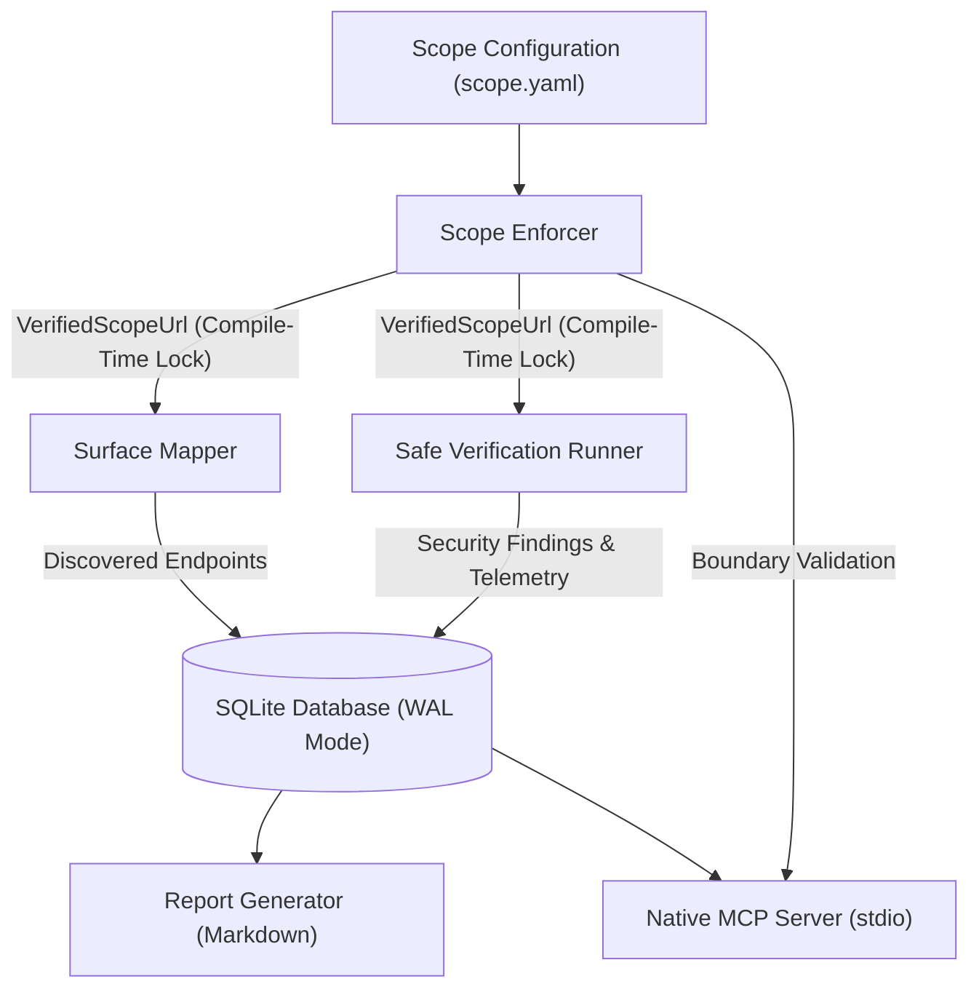

# BountyScope

[](file:///home/stringray/BountyScope/Cargo.toml)
[](file:///home/stringray/BountyScope/LICENSE)

BountyScope is a scope-locked reconnaissance, passive policy auditing, and Model Context Protocol (MCP) triage command-line interface written in Rust. It is engineered for authorized bug bounty programs, defensive security reviews, and vulnerability disclosure assessments. The system guarantees strict scope boundaries, non-destructive policy evaluation, deterministic rate limiting, and compile-time target verification before executing any network interactions.

---

## Core Safety Guarantees

BountyScope enforces four architectural invariants across all discovery and audit flows:

1. **Compile-Time Scope Enforcement (`VerifiedScopeUrl`):**
   Outbound HTTP clients within the engine strictly require a `VerifiedScopeUrl` token as their target parameter. Because `VerifiedScopeUrl` has a private constructor that can only be minted by `ScopeEnforcer::validate_url()`, raw strings or unvalidated URLs cannot be dispatched across the network, eliminating scope escapes at compile time.

2. **Path-Traversal and FQDN Normalization:**
   Target URLs and candidate endpoints undergo strict canonicalization prior to boundary checks. The enforcer normalizes duplicate slashes (`//`), directory traversal sequences (`/..`, `/%2e%2e/`), and trailing domain dots (`example.com.` -> `example.com`), while matching wildcard DNS boundaries (`*.example.com`) against public suffix rules.

3. **Deterministic Rate Limiting, Non-Redirecting Transport & Payload Ceiling:**
   The network transport layer is configured with `reqwest::redirect::Policy::none()`, preventing automatic redirect following (HTTP 301/302/307/308) into unverified domains. Inter-request pacing is governed deterministically by `rate_limit_rps` (defaulting to 2 requests per second in safe mode), and streamed responses are constrained to a strict 5 MiB (`MAX_RESPONSE_BODY_BYTES`) ceiling to prevent unbounded memory consumption.

4. **Stdio JSON-RPC 2.0 Framing Isolation:**
   When running the native Model Context Protocol (MCP) server, all tracing, diagnostic logging, and error output are routed strictly to standard error (`stderr`). Standard output (`stdout`) is preserved exclusively for newline-delimited JSON-RPC 2.0 frames, preventing transport protocol corruption.

---

## Architecture Pipeline

The following diagram illustrates the unidirectional data pipeline from configuration loading through scope enforcement, surface mapping, verification, and MCP serving:



---

## Installation & Prerequisites

### Prerequisites

- **Rust Toolchain:** Rust 1.80+ (2021 edition) with `cargo`
- **Ubuntu/Debian Build Dependencies:**
  ```bash
  sudo apt-get update
  sudo apt-get install -y pkg-config libssl-dev libsqlite3-dev valgrind
  ```
- **Docker Compose:** (optional, required for running the local offline testing lab)

### Building from Source

```bash
# Clone repository
git clone https://github.com/Rohinthan/BountyScope.git
cd BountyScope

# Build release binary
cargo build --release

# Install globally to ~/.cargo/bin
cargo install --path .

# The binary is available on PATH as bountyscope
bountyscope --version
```

### Quality and Verification Checks

```bash
# Verify code formatting
cargo fmt --check

# Run static analysis and lints
cargo clippy --all-targets --all-features -- -D warnings

# Execute test suite
cargo test
```

---

## Configuration Reference (`scope.yaml`)

BountyScope requires a YAML configuration file defining the program boundaries and Rules of Engagement (RoE).

### Configuration Schema

| Field | Type | Required | Description |
|---|---|---|---|
| `program_name` | String | Yes | Unique program identifier. |
| `platform` | String | Yes | Vulnerability disclosure platform (e.g., `hackerone`, `bugcrowd`, `intigriti`, `self_hosted`). |
| `allowed_domains` | List of Strings | Yes | Authorized domain patterns and wildcard expressions (e.g., `example.com`, `*.example.com`). |
| `excluded_domains` | List of Strings | No | Subdomains or third-party hosts explicitly excluded from testing. |
| `excluded_paths` | List of Strings | No | URL path prefixes explicitly excluded (e.g., `/logout`, `/admin/delete`). |
| `excluded_checks` | List of Strings | No | Finding types to skip during audits (e.g., `missing_security_headers`). |
| `rate_limit_rps` | Integer | No | Maximum outbound requests per second (default: `2`). |
| `safe_mode` | Boolean | No | Enforces safe read-only testing defaults (default: `true`). |
| `researcher_handle` | String | No | Attaches `X-Bug-Bounty: <handle>` header to outbound HTTP requests for attribution. |
| `policy_url` | String | No | URL to the governing bug bounty policy or Safe Harbor terms. |

### Example Configuration (`configs/scope.example.yaml`)

```yaml
program_name: "example-security-program"
platform: "hackerone"
allowed_domains:
  - "example.com"
  - "*.example.com"
  - "127.0.0.1"

excluded_domains:
  - "auth.example.com"
  - "payments.example.com"
  - "status.example.com"

excluded_paths:
  - "/logout"
  - "/oauth/revoke"
  - "/account/delete"
  - "/api/v1/auth/signout"

excluded_checks:
  - "missing_security_headers"

rate_limit_rps: 2
safe_mode: true
researcher_handle: "security-researcher"
policy_url: "https://hackerone.com/example-security-program"
```

---

## CLI Command Reference

BountyScope provides a suite of subcommands for validation, passive mapping, verification, reporting, and MCP integration.

### Environment Variable Fallback (`BOUNTYSCOPE_CONFIG`)

All subcommands accept the `BOUNTYSCOPE_CONFIG` environment variable as a fallback for the `--config` parameter:

```bash
export BOUNTYSCOPE_CONFIG="configs/scope.example.yaml"
```

When set, the `--config` flag can be omitted from any command invocation.

### Automatic Database and Report Path Derivation

The `--db` parameter is optional across all commands. When omitted, BountyScope automatically derives a deterministic database path at `data/<sanitized_program_name>.db` and creates parent directories automatically.

Similarly, `--output` on `report` and `scan` defaults to `data/<sanitized_program_name>_report.md`. To print reports directly to standard output, pass the `--stdout` flag to `report`.

### Command Matrix

| Command | Purpose | Input Flags | Output |
|---|---|---|---|
| `validate-scope` | Verifies YAML syntax and scope boundary integrity. | `[--config]` | Console validation summary |
| `scan` | Unified pipeline: maps surface, audits endpoints, and exports report. | `--url`, `[--config]`, `[--db]`, `[--output]` | SQLite database and Markdown report |
| `probe` | Safely evaluates and probes a single in-scope URL. | `--url`, `[--config]`, `[--db]` | HTTP status, headers, audit log entry |
| `map` | Passively extracts links, scripts, and API specs from a seed URL. | `--url`, `[--config]`, `[--db]` | Discovered endpoints in SQLite |
| `audit` | Evaluates HTTP headers, CORS policies, and spec disclosures. | `[--config]`, `[--db]` | Audit findings summary |
| `report` | Generates a Markdown assessment report with findings and evidence. | `[--config]`, `[--db]`, `[--output]`, `[--stdout]` | Markdown report (file or stdout) |
| `mcp` | Launches the Model Context Protocol server over standard I/O (`stdio`). | `[--config]`, `[--db]` | JSON-RPC 2.0 protocol on stdout |

### 1. Unified Assessment Scan (`bountyscope scan`)

Execute surface mapping, passive policy verification, and Markdown report export in a single command:

```bash
# Unified scan with explicit configuration
bountyscope scan --url http://127.0.0.1:8080/ --config configs/scope.example.yaml

# Unified scan using BOUNTYSCOPE_CONFIG and automatic path derivation
export BOUNTYSCOPE_CONFIG=configs/scope.example.yaml
bountyscope scan --url http://127.0.0.1:8080/
```

Sample output:
```text
Target scope initialized for program 'example-security-program'
Database: "data/example_security_program.db"
Starting passive surface mapping from http://127.0.0.1:8080/...
Surface mapping complete: 14 endpoints discovered (9 in-scope, 5 out-of-scope discarded)
Starting non-destructive security verification...
Audit completed: 9 endpoints audited, 6 total findings
  CRITICAL: 0
  HIGH:     1
  MEDIUM:   1
  LOW:      3
  INFO:     1
Assessment report generated successfully: "data/example_security_program_report.md"
```

### 2. Validate Scope Configuration

```bash
bountyscope validate-scope --config configs/scope.example.yaml
```

Sample output:
```text
Scope configuration valid: example-security-program (platform: hackerone, allowed_domains: 3, excluded_domains: 3, excluded_paths: 4, rate_limit_rps: 2, safe_mode: true)
```

### 3. Safely Probe Target Endpoint

```bash
# Database automatically defaults to data/example_security_program.db
bountyscope probe --config configs/scope.example.yaml --url http://127.0.0.1:8080/openapi.json
```

Sample output:
```text
Probe successful: http://127.0.0.1:8080/openapi.json -> HTTP 200 (application/json, 538 bytes, 3 ms)
```

### 4. Passively Map Attack Surface

```bash
bountyscope map --config configs/scope.example.yaml --url http://127.0.0.1:8080/
```

Sample output:
```text
Surface mapping complete for http://127.0.0.1:8080/: 14 endpoints discovered (9 in-scope, 5 out-of-scope discarded)
  [seed] http://127.0.0.1:8080/ (HTTP 200)
  [html_link] http://127.0.0.1:8080/dashboard (unprobed)
  [html_script] http://127.0.0.1:8080/static/app.js (HTTP 200)
  [js_route] http://127.0.0.1:8080/api/v1/users (unprobed)
  [js_route] http://127.0.0.1:8080/api/v2/metrics (unprobed)
  [js_route] http://127.0.0.1:8080/graphql (unprobed)
  [robots_txt] http://127.0.0.1:8080/robots.txt (HTTP 200)
  [robots_txt] http://127.0.0.1:8080/admin (unprobed)
  [openapi_spec] http://127.0.0.1:8080/openapi.json (HTTP 200)
```

### 5. Audit Mapped Endpoints

```bash
bountyscope audit --config configs/scope.example.yaml
```

Sample output:
```text
Audit completed for program 'example-security-program': 9 endpoints audited, 6 total findings
  CRITICAL: 0
  HIGH:     1
  MEDIUM:   1
  LOW:      3
  INFO:     1
```

### 6. Generate Assessment Markdown Report

```bash
# Output defaults to data/example_security_program_report.md
bountyscope report --config configs/scope.example.yaml

# Or print directly to standard output
bountyscope report --config configs/scope.example.yaml --stdout
```

### 7. Serve Model Context Protocol (MCP)

```bash
bountyscope mcp --config configs/scope.example.yaml
```

---

## Model Context Protocol (MCP) Integration

BountyScope implements a native Model Context Protocol (MCP) server conforming to JSON-RPC 2.0 specifications via `rmcp`. It enables external AI coding assistants, autonomous security agents, and defensive consoles to query scope boundaries and assessment findings.

### Exposed MCP Tools

1. **`check_target_scope`**
   - **Input:** `{ "url": "https://example.com/api/v1" }`
   - **Output:** `{ "allowed": true, "normalized_url": "https://example.com/api/v1", "reason": null }`
   - **Function:** Allows external AI agents to verify whether a URL is in-scope prior to taking actions.

2. **`list_mapped_endpoints`**
   - **Input:** `{ "limit": 50 }`
   - **Output:** Array of discovered endpoint records (`url`, `host`, `path`, `status_code`, `discovered_via`).
   - **Function:** Retrieves attack surface inventory stored in SQLite.

3. **`list_security_findings`**
   - **Input:** `{ "severity": "HIGH" }` (optional filter: `CRITICAL`, `HIGH`, `MEDIUM`, `LOW`, `INFO`)
   - **Output:** Array of verified findings (`id`, `finding_type`, `severity`, `title`, `target_url`, `evidence`, `remediation`).
   - **Function:** Queries verified security findings and policy violations.

4. **`generate_assessment_report`**
   - **Input:** `{}`
   - **Output:** `{ "report": "# Security Assessment Report: ...\n..." }`
   - **Function:** Returns the full synthesized Markdown assessment report.

### MCP Client Configuration

Add BountyScope to your MCP client configuration (such as Antigravity IDE `~/.gemini/antigravity/mcp_config.json` or Claude Desktop `claude_desktop_config.json`):

```json
{
  "mcpServers": {
    "bountyscope": {
      "command": "bountyscope",
      "args": [
        "mcp",
        "--config", "configs/scope.example.yaml",
        "--db", "data/bountyscope.db"
      ]
    }
  }
}
```

---

## Offline Local Testing Lab

An offline local testing lab is provided in [lab/](file:///home/stringray/BountyScope/lab) featuring OWASP Juice Shop and a mock vulnerable API server bound strictly to loopback (`127.0.0.1`):

```bash
# Navigate to lab directory and start services
cd lab
docker compose up -d

# Verify services are responsive
curl -s http://127.0.0.1:3000/ | head -n 5
curl -s http://127.0.0.1:8080/openapi.json | head -n 5

# Run surface mapping and verification against local lab
cd ..
bountyscope map --config configs/scope.example.yaml --url http://127.0.0.1:8080/ --db data/bountyscope.db
bountyscope audit --config configs/scope.example.yaml --db data/bountyscope.db
bountyscope report --config configs/scope.example.yaml --db data/bountyscope.db

# Stop lab services
cd lab
docker compose down
```

See [Doc/04_LOCAL_LAB_GUIDE.md](file:///home/stringray/BountyScope/Doc/04_LOCAL_LAB_GUIDE.md) for complete details on lab architecture and target endpoints.

---

## Technical Documentation Index

Detailed architectural and implementation documentation is available in the [Doc/](file:///home/stringray/BountyScope/Doc) directory:

- [01_SYSTEM_OVERVIEW.md](file:///home/stringray/BountyScope/Doc/01_SYSTEM_OVERVIEW.md): Mission, scope governance model, and pipeline summary.
- [02_ARCHITECTURE.md](file:///home/stringray/BountyScope/Doc/02_ARCHITECTURE.md): Component diagrams, `VerifiedScopeUrl` state pattern, SQLite schema, and MCP server design.
- [03_SECURITY_CHECKS.md](file:///home/stringray/BountyScope/Doc/03_SECURITY_CHECKS.md): Check logic for headers, CORS, OpenAPI specs, static asset exemptions, and false-positive filtering.
- [04_LOCAL_LAB_GUIDE.md](file:///home/stringray/BountyScope/Doc/04_LOCAL_LAB_GUIDE.md): Lab configuration, mock API definitions, and testing workflows.

---

## Authorized Use & License

### Authorized Use Notice

BountyScope is designed exclusively for authorized penetration testing, bug bounty programs, and defensive vulnerability assessments conducted in full compliance with applicable laws, Terms of Service, and program Rules of Engagement. Unauthorized network probing or scanning of systems without explicit written permission is strictly prohibited.

### License

This project is licensed under the **Apache License, Version 2.0**. See the [LICENSE](file:///home/stringray/BountyScope/LICENSE) file for the full license text.
